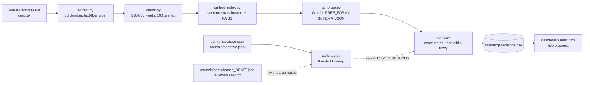
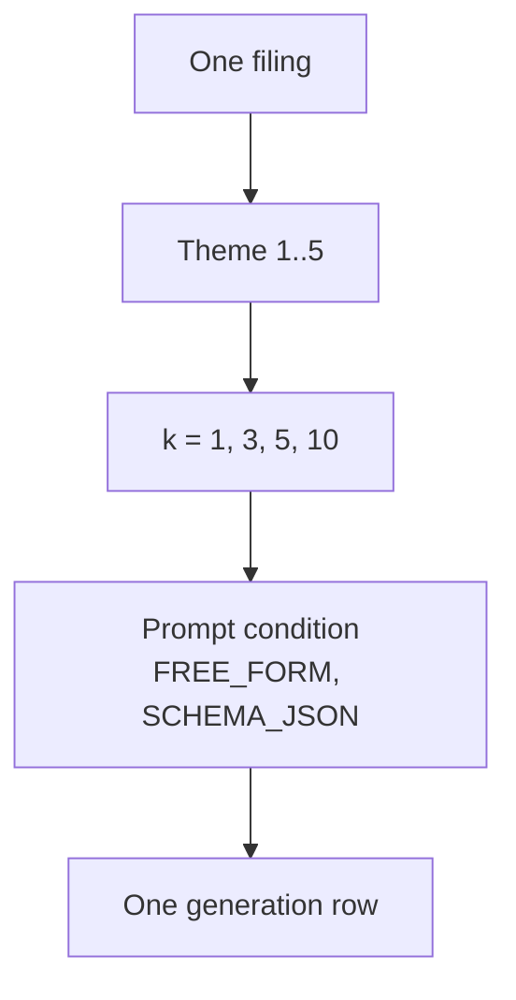
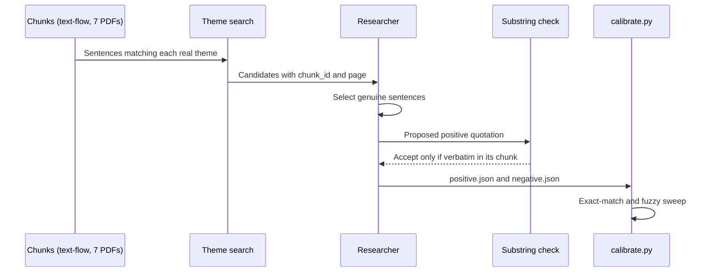
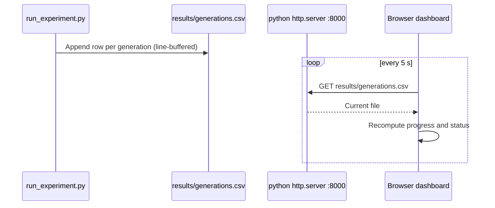

# Quotation-Fidelity Pipeline: Build Process, Decisions, and Status

Status date: 2026-10-18. This is a process and status report. The full 200-generation grid was run for the first time on 2026-10-18 and is reported in Section 6a: zero fabrications, with the grounded rate turning out to be an abstention rate. Those figures describe `gemini-3.5-flash-lite`, not the `gemini-3.8-flash` the design in Section 2 was written against, and the interpretation and write-up of the result are still open. The calibration figures in Section 8a are control-set measurements, not experimental results.

## 1. Purpose

The study asks whether a language model, given excerpts from Indian annual reports, produces verbatim quotations that actually appear in the source, and how often it fabricates them. The pipeline is a standalone research version of the grounding guard planned for the production Filing Analyst Agent (RedShift SRS/SDS v9, Component 3; FR-31). Measurements from this study are meant to set the verifier threshold used in production.

## 2. Experimental design (as planned, with what was run)

| Element | Plan | Run on 2026-10-18 | Notes |
|---|---|---|---|
| Companies | Up to 15 | 5 | Corpus has seven PDFs; five are usable (Section 4) |
| Themes | 5 | 5 | auditor qualifications and emphases of matter; related-party transactions; promoter share pledging; going-concern disclosures; contingent liabilities and guarantees |
| Retrieval depth k | 1, 3, 5, 10 | 1, 3, 5, 10 | |
| Prompt conditions | 2 | 2 | FREE_FORM and SCHEMA_JSON |
| **Generation model** | `gemini-3.8-flash` | **`gemini-3.5-flash-lite`** | **Changed on 2026-10-17 for free-tier quota reasons, before any generation was run.** The premium Flash models allow 20 requests a day on this project, which puts the 200-generation grid at about ten days; the Flash-Lite tier allows 500 a day at 15 RPM, which completes it in about 13 minutes. No result was ever produced on `gemini-3.8-flash`, so nothing in this paper mixes the two. Set by `MODEL_NAME` in `src/generate.py` |
| Generations | up to 600 | 200 | With the five usable filings the grid is 5 x 5 x 4 x 2 = 200 |
| Verifier | Fuzzy matching, threshold 0.80 | same | Chosen from the calibration sweep on the control sets (Section 8a). Not a validated constant. Does not reliably accept real paraphrases |

Decision: the grid is scaled to the filings actually available (200 generations, from Yes Bank, IL&FS, Infosys, TCS and HUL), not padded to 600. DHFL and Manpasand are excluded until their files are replaced (Section 4). Reducing the company count changes the power of the crisis-versus-control comparison and must be stated in the paper.

Scope of the model change. The study measures the quotation fidelity of `gemini-3.5-flash-lite`, and every figure in Section 6a is a property of that model under this prompt and this corpus. The results are not evidence about `gemini-3.8-flash` or about the premium Flash tier, and the paper must not generalise across them. A model's fidelity is not a fixed quantity, so a cheaper or smaller model is not assumed to fabricate more or less than a larger one; the comparison was not run, because the free tier does not permit it.

## 3. Environment

- Machine: Apple M3 (arm64), macOS 26.5.2. Python 3.11 in a project virtualenv (`venv/`), standardised on 2026-10-17. The earlier 3.9.6 venv is archived and no longer used. Two patch versions are on record and both are reported in Section 13.3: the calibration figures were computed under **3.11.15**, and the environment rebuilt from `requirements.lock.txt` on 2026-10-17 resolves **3.11.17**, under which every calibration figure was re-verified unchanged.
- Dependencies: pdfplumber, sentence-transformers, faiss-cpu, google-genai (see `requirements.txt` and the lock file in Section 13.3).
- Model access: Gemini API key set through a local `.env` file, not committed. Generation model `gemini-3.5-flash-lite` (Section 2).
- Decision: heavy steps (embedding, FAISS, generation) run on the researcher's own machine, not in a cloud sandbox, because the sandbox could not install the packages or reach PyPI.

Known risks and their state (2026-10-18):
- Python version: the 3.11 line is standardised. Under 3.11.15 the calibration sweeps, the held-out check, the chunk counts and the flip count matched the earlier 3.9.6 results exactly (Section 13.3). Re-run under 3.11.17 on 2026-10-18: the calibration sweeps, the held-out check and the chunk counts match, and the verifier classification metrics match except for two AUC values that moved for an unrelated reason, traced to the control repair rather than the interpreter (Sections 8a and 8c). Not re-run under 3.11.17: the flip count and the retrieval check.
- SDK: `generate.py` uses `google-genai` 2.31.0. The deprecated `google-generativeai` package is no longer used. The migrated client has now been exercised live for all 200 generations (Section 6a), in addition to the offline tests of its request shape and retry loop (`tests/test_generate.py`).
- Fuzzy matching: `difflib` is kept, not `rapidfuzz`. This is a stated limitation (Section 7).

### Figure 1. Pipeline stages



Status (2026-10-18): every stage has been built and run on the real corpus. A, B, C, F, H on the corpus; D (embedding and FAISS) first run 2026-10-17; E (generation) run live for all 200 generations on 2026-10-18 (Section 6a); I, J on the current controls; K reviewed 2026-10-17.

### Figure 2. Experiment grid per filing



Each filing contributes 5 x 4 x 2 = 40 rows. Five filings give the 200-row expected total used by the dashboard.

### Figure 3. Control-set build and verification



### Figure 4. Monitoring path during a run



## 4. Corpus

Seven annual-report PDFs are in `corpus/`. Five are usable. Fiscal years follow the plan: each crisis company is taken at the last report before its public crisis; clean controls use the most recent report.

| Company | Role | Fiscal year used | File | Status |
|---|---|---|---|---|
| Yes Bank | Crisis | FY2020 | yes-bank-fy2020.pdf | Usable |
| DHFL | Crisis | FY2019 (label) | dhfl-fy2019.pdf | **Excluded**: the file is the 2017-18 report |
| IL&FS | Crisis | FY2018 | ilfs-fy2018.pdf | Usable; fiscal year confirmed from the body text (year ended 31 March 2018) |
| Manpasand Beverages | Crisis | FY2018 | manpasand-fy2018.pdf | **Excluded**: partial text layer |
| Infosys | Control | FY2025 | infosys-fy2025.pdf | Usable |
| TCS | Control | latest (FY2026) | tcs-latest.pdf | Usable |
| HUL | Control | latest (FY2026) | hul-latest.pdf | Usable |

Decisions and open issues:
- Manpasand FY2018 was kept over the later FY2020 report. Using a post-crisis report would break the design, since the crisis companies' pre-crisis disclosures are the comparison baseline.
- Cover-page check (2026-10-14), from page 1 of each file:
  - Yes Bank: exchange letter dated 17 August 2020 for the 2019-20 report. Consistent with FY2020.
  - Infosys: Integrated Annual Report 2024-25. Consistent with FY2025.
  - TCS: Integrated Annual Report 2025-26, labelled "latest". Consistent.
  - HUL: Integrated Annual Report 2025-26, labelled "latest". Consistent.
  - IL&FS: "Annual Report 2018" on the cover. The body text states the year ended 31 March 2018 (FY 2017-18), with 2017 as comparative (directors' report, balance sheet "as at March 31, 2018", and P&L and cash-flow headings; checked 2026-10-17 by text search, page numbers as extracted from the PDF). The "March 31, 2019" hits are RBI deadlines and plans, not year-ends. No separate auditor's report heading was found in the text layer, so the auditor's report was not checked directly.
  - DHFL: the file is the **Annual Report 2017-18**, not FY2019 as labelled. The file must be replaced with the 2018-19 report, or the label and the design must be changed.
  - Manpasand: page 1 is a 17 September 2018 exchange filing letter, not the annual report. Of 131 pages, 12 are blank, and some are image-only, so the text layer is partial. The source must be replaced with a text-based annual report.
- Infosys is labelled FY2025 by its filename. The "latest" labels for TCS and HUL are resolved: both cover pages read "Integrated Annual Report 2025-26", so both are the year ending 31 March 2026, and HUL's body text confirms it ("year ended 31st March, 2026"). The manifest records both as fiscal year 2026, and the chunk IDs read `TCS_2026_*` and `HUL_2026_*`. The filenames were left as `tcs-latest.pdf` and `hul-latest.pdf` because the SHA-256 digests in Section 13.1 are recorded against those names; renaming them would invalidate the digest table.
- Filing count: the earlier plan and the dashboard assumed seven filings (280 generations). The manifest now lists five, so the target is 200. This is a reduction in the company count and is stated as a limitation.

## 5. Process: planned versus actual

| Stage | Planned (runbook) | What was done | Status |
|---|---|---|---|
| 0. Setup | Unpack, venv, install, API key | Unpacked to `~/quotation-fidelity`; venv created; dependencies installed; key active | Done |
| Version control | Not specified | Commits on `main` through `eabe42f`. Round of changes dated 2026-10-17 partly uncommitted (Section 12) | Partial |
| 1. Corpus | Download 7 PDFs; verify fiscal years | All 7 downloaded; cover pages checked; five usable | Done with exclusions |
| 2. Extraction sanity check | Run extract and chunk on one PDF | All seven re-extracted with text-flow order on 2026-10-17 | Done |
| 3. Controls (manual) | Hand-copy 20+ genuine sentences and 20+ absent ones | Stopped at 17 positive (abstract commits to 20; shortfall stated, Section 8), 20 negative | Done, with shortfall |
| 4. Calibration | Run `calibrate.py`; set threshold from the sweep | Run on the current controls (Section 8a); threshold 0.80 | Done, with limits |
| 4b. Retrieval check | Recall@k with and without the 200-word limit | Quote-as-query recall run (Section 6). Gold chunk in top 10 for 3 of 17 positives. The explicit with/without comparison not run | Partial |
| 4c. Control integrity | Not planned | Controls checked against the real corpus for the first time on 2026-10-18 and repaired (Section 8c). `check_controls.py` added so the check is repeatable | Done |
| 5. Dry run | 1 filing, check the row format | Run 2026-10-18 on Infosys, k=1, 2 generations; CSV read before the grid was started | Done |
| 6. Full run | About 200 generations (five filings) | Run 2026-10-18 on `gemini-3.5-flash-lite`. All 200 cells completed in one session; 3 transient API failures retried. Results in Section 6a | Done |
| 7. Adversarial test and labelling | Steered copies; two annotators; kappa | Not started. The adversarial variant is not in the code. The baseline has zero fabrications, so there are no category-4 failures to label and the kappa pass has no material | Pending |
| 8. Paper | Full paper from real numbers | This document is the process report plus the run of 2026-10-18 (Section 6a). The full paper is not written | Pending |

## 6. Measured results so far

Extraction and chunking use the project's own `extract.py` and `chunk.py`: text-flow page extraction (`use_text_flow=True`), and chunks of 500 to 800 whitespace-delimited words with 100-word overlap. The counts below are from the text-flow run of 2026-10-17. They replace an earlier default-extraction run, whose chunk counts and chunk IDs are not valid.

| Filing | Pages | Chunks (text-flow) | Chunks (earlier default run) | Extractable |
|---|---|---|---|---|
| Infosys FY2025 | 369 | 261 | 257 | Yes |
| TCS latest | 360 | 276 | 243 | Yes |
| HUL latest | 244 | 302 | 294 | Yes |
| Yes Bank FY2020 | 359 | 297 | 299 | Yes |
| IL&FS FY2018 | 334 | 135 | 135 | Yes |
| DHFL FY2019 | 266 | 204 | 189 | Yes |
| Manpasand FY2018 | 131 | 19 | 18 | Yes |
| **Total** | **2,063** | **1,494** | **1,435** | |

Why extraction order matters. The default extractor orders text by position on the page. On two-column layouts this interleaves the two columns, so a sentence that wraps across the columns is split by text from the other column. Two genuine sentences checked on 2026-10-17 were scored as fabrications under the default order (Infosys, Annexure 7, PDF page 66: PURE_FABRICATION, score 0.676; Yes Bank, Social section, PDF page 69: PURE_FABRICATION, score 0.399). Under text-flow order both are EXACT_MATCH with score 1.0. Without this change the pipeline would count genuine quotations that span a column break as fabrications, which would inflate the fabrication rate the study measures.

Flip count (2026-10-17, substring match over all five usable filings, `normalise` applied). Default order matches 15 of the 17 positives; text-flow matches all 17. The two flips are the two sentences added on the same day, both in the default-miss direction. No quotation flips in the other direction, and no negative control matches under either order, so text-flow adds no false positives on these controls. The 26 paraphrases match under neither order, because they are paraphrases by design. The paraphrase group therefore adds no signal to this comparison.

Text quality, separate from the `extractable` flag: the text layers of the crisis filings (Yes Bank, DHFL, IL&FS, Manpasand) carry sidebar labels and table cells in the body text. Text-flow order keeps running sentences contiguous but does not remove sidebar text. Sentence-level search on those filings returns fewer clean sentences than on the clean-control filings.

Concern: Manpasand gives 19 chunks from 131 pages, about a fifth of the chunk density of the other filings. Either the text layer is sparse (scanned or image-heavy pages) or extraction is losing text. The `extractable` flag only tests average characters per page, so it does not catch partial extraction. Manpasand is excluded from the manifest for this reason.

### Retrieval check (quotation as query)

One FAISS index over the 1,494 text-flow chunks, with `all-MiniLM-L6-v2` embeddings and inner-product search on normalised vectors. The query is each positive quotation. A hit is the gold chunk ID appearing in the top k. All 17 gold chunks are in the index.

| k | Hits (of 17) | Recall |
|---|---|---|
| 1 | 1 | 0.059 |
| 3 | 2 | 0.118 |
| 5 | 2 | 0.118 |
| 10 | 3 | 0.176 |

Result. With the quotation as the query, the gold chunk is in the top 10 for only 3 of 17 positives. A low recall means the generator may never see the chunk a quotation came from, which limits what the study can test.

Caveat. The production queries are the five theme queries, not the quotations. The quote-as-query experiment measures something else, so the 3 of 17 figure cannot be generalised to the pipeline.

Truncation. The embedder already truncates silently. `all-MiniLM-L6-v2` has a maximum sequence length of 256 word pieces (checked 2026-10-17), which is about 200 words. Each 500–800-word chunk is therefore embedded only through its first part. The explicit comparison with and without this limit has not been run. A scratch run with a 200-word cut and with no cut gave identical recall, but both passed through the embedder's own 256-piece limit, so that run does not measure the effect of the cut. The pipeline has no separate truncation step, and none has been added.

## 6a. First full experimental run (2026-10-18)

The complete grid was run for the first time on 2026-10-18: 5 filings x 5 themes x k in {1,3,5,10} x 2 prompt conditions = 200 generations, all on `gemini-3.5-flash-lite`. All 200 cells are present exactly once, with no duplicates and no missing cells. Three generations failed on transient infrastructure errors (one HTTP 503 "high demand", one connection reset, one server disconnect); all three were retried successfully, and the `api_error` rows are retained in `results/generations.csv` for the record, giving 203 rows and 200 usable generations.

| Outcome | n | Share |
|---|---|---|
| `exact_match` | 134 | 67.0% |
| `fuzzy_match` | 3 | 1.5% |
| `no_finding` | 63 | 31.5% |
| `provenance_mismatch` | 0 | 0.0% |
| `pure_fabrication` | 0 | 0.0% |
| `unparsed_output` | 0 | 0.0% |
| `schema_failure_after_retries` | 0 | 0.0% |

**Zero fabrications and zero provenance mismatches.** Of the 137 generations that produced a quotation, 137 verified against the chunk the model itself cited.

Independent audit of that result (2026-10-18). The headline is produced by the same verifier that wrote the labels, against only the k chunks supplied for that generation, so it was re-checked from scratch against the whole corpus rebuilt from the PDFs:

- All 134 `exact_match` quotations are present in the 1,271-chunk corpus, and every one is present in the chunk the model claimed. None was found in a different chunk, which would have been a missed `provenance_mismatch`.
- No generation cited a chunk ID that is not a real chunk.
- The matches are not trivially short: quotation length is 8 to 157 words, median 43; 46 to 963 characters as returned, median 271, or 44 to 963 after `normalise()` collapses whitespace. None falls below the verifier's `MIN_ALNUM_CHARS` rule, and only 3 are under 10 words.

### The grounded rate is an abstention rate

| Dimension | Group | n | Quoted | Grounded | Grounded, of those that quoted | Abstained |
|---|---|---|---|---|---|---|
| k | 1 | 50 | 23 | 46.0% | **100.0%** | 54.0% |
| k | 3 | 50 | 33 | 66.0% | **100.0%** | 34.0% |
| k | 5 | 50 | 38 | 76.0% | **100.0%** | 24.0% |
| k | 10 | 50 | 43 | 86.0% | **100.0%** | 14.0% |
| condition | `free_form` | 100 | 67 | 67.0% | **100.0%** | 33.0% |
| condition | `schema_json` | 100 | 70 | 70.0% | **100.0%** | 30.0% |

Because fidelity is 100% in every cell, the grounded rate is exactly one minus the abstention rate throughout. **Every difference in the table — including the rise from 46% to 86% across k — is a difference in how often the model declined to answer, not in how faithfully it quoted when it did.** The k effect is therefore a retrieval-coverage result: supplying more chunks makes it more likely the relevant disclosure is in front of the model at all. It must not be reported as fidelity improving with retrieval depth. The same applies to the 3-percentage-point gap between the prompt conditions, which is three generations and is entirely abstention.

The consequence for the study is uncomfortable and should be stated plainly: with zero fabrications anywhere, this run has **no variance in the dependent variable**, so it cannot discriminate between themes, retrieval depths or prompt conditions on quotation fidelity. It establishes an upper bound on fabrication for this model and prompt on this corpus; it does not measure a fabrication rate.

### Abstention is themed, not random

Abstentions per filing and theme (of 8 generations each):

| Theme | HUL | IL&FS | Infosys | TCS | Yes Bank |
|---|---|---|---|---|---|
| auditor qualifications and emphases of matter | 3 | 0 | 2 | 2 | 2 |
| contingent liabilities and guarantees | 0 | 0 | 2 | 0 | 0 |
| going-concern disclosures | 5 | 4 | 5 | 0 | 6 |
| promoter share pledging | 6 | 2 | **8** | **8** | 6 |
| related-party transactions | 0 | 2 | 0 | 0 | 0 |

The pattern tracks whether the disclosure plausibly exists. Related-party and contingent-liability disclosures are mandatory and essentially never abstained on. Promoter share pledging is abstained on in all 8 generations for both Infosys and TCS, neither of which has pledged promoter holdings. Limitation: this correspondence was read off the filings' character, not verified. Nobody has confirmed that each abstention is correct — that the filing genuinely lacks the disclosure rather than the retrieval having missed it. Until that is checked, 31.5% abstention cannot be separated into "correctly silent" and "failed to retrieve", and given the retrieval recall recorded in Section 6 the second cannot be assumed small.

### The fuzzy matches are extraction artefacts, not paraphrase

All three non-exact groundings come from the same cause, the rupee glyph surviving extraction as a backtick:

| Filing | Theme | k | Score | Quotation opens |
|---|---|---|---|---|
| Infosys | related-party transactions | 10 | 0.886 | "Since the estimated aggregate value (\`2,975 crore or 1.83% of annual consolidated turnover) ..." |
| Infosys | related-party transactions | 10 | 0.886 | same sentence, `schema_json` condition |
| IL&FS | promoter share pledging | 10 | 0.993 | "\`(ii) Shareholding of Promoters : Not Applicable, as the Company is Professionally managed ..." |

This is live confirmation of what Section 8a predicted the 0.80 threshold would be doing: absorbing extraction noise, not paraphrase. The two Infosys rows are the same sentence found independently under both prompt conditions, so the three rows represent two distinct sentences.

### Scope

The figures above describe `gemini-3.5-flash-lite`, which replaced `gemini-3.8-flash` for free-tier quota reasons on 2026-10-17 (see the development log). They are not comparable to a 3.8-Flash run, and Sections 2 and 13 describe the design as planned against the earlier model. The study's abstract and design must be reconciled with the model actually measured before these numbers are reported as the study's result.

## 7. Verifier

- `verify.py` uses Python's standard `difflib`. `rapidfuzz` was planned but could not be installed in the build environment. The threshold does not transfer between the two libraries, so the calibration must be run on the library actually used.
- `normalise()` applies NFKC normalisation, collapses whitespace, unifies quote marks, and rejoins hyphenated line-wrap breaks.
- Decision (2026-10-17): keep `difflib`. Switching to `rapidfuzz` would change the fuzzy scores and so require recalibrating `FUZZY_THRESHOLD`, and the sweep in Section 8a would have to be re-run and re-reported. Limitation: the fuzzy scores and the 0.80 threshold are specific to `difflib.SequenceMatcher`.
- Smoke tests: 4 of 4 pass (2026-10-17).
- `FUZZY_THRESHOLD = 0.80`. See Section 8a for the basis and its limits.
- Overlap rule (2026-10-17). Adjacent chunks share a 100-word overlap, so a quotation inside the overlap matches two chunks. Both stages check the claimed chunk first. A match on the claimed chunk is EXACT_MATCH or FUZZY_MATCH on that chunk. Only if the claimed chunk does not match is another supplied chunk checked, which gives PROVENANCE_MISMATCH. If nothing matches, the result is PURE_FABRICATION. Eight unit tests in `tests/test_overlap.py` cover the overlap cases; all pass. The sweep in Section 8a supplies only the claimed chunk, so its numbers do not depend on this rule.

## 8. Control sets

Two process errors occurred here and are recorded in full.

1. Themes. The quotation-finder script (`src/find_quotations.py`) and the first control templates were built around themes I had invented (revenue growth, revenue decline, asset quality, regulatory breach, cash-flow pressure). These do not match the experiment's themes in `src/generate.py`. The suggestions from that script must be discarded.
2. Search quality. Keyword regular expressions over PDF text returned mostly table-of-contents lines, headers, and fragments. It is not a usable source of control sentences without manual checking.

Corrected approach:

1. All seven filings were chunked with the pipeline's own code. The current chunks use text-flow order (1,494 chunks).
2. Each of the five real themes was searched across the chunks, first with broad patterns, then with stricter filters (no table-like digit runs, no page-header vocabulary, length 80 to 220 characters).
3. Positive controls are sentences copied verbatim from a named chunk. Each must match its chunk exactly under the current extraction. All 17 current positives pass.
4. Negative controls are plausible financial-audit sentences. Each must be absent from the normalised text of all seven filings. All 20 pass.
5. `verify.verify_quotation` was run on each control against its own chunk. All 17 positives return EXACT_MATCH and all 20 negatives return PURE_FABRICATION.

Changes to the positive set on 2026-10-17, after the text-flow switch:
- 14 positives were remapped to the chunk IDs that contain their quotes under text-flow order. Chunk numbers had shifted.
- The two DHFL positives were removed. They cited `DHFL_2019_c0156`, which is in the 2017-18 report.
- One HUL positive (the garbled pledging sentence) was removed because no chunk contains it.
- Two sentences were added, both tagged as outside the five study themes: the Infosys resource-conservation sentence (`Infosys_2025_c0053`, Annexure, PDF page 66) and the Yes Bank group-capabilities sentence (`Yes Bank_2020_c0044`, Social section, PDF page 69).

Results of the control set:

| Theme | Positives | Negatives |
|---|---|---|
| Auditor qualifications and emphases of matter | 4 | 4 |
| Related-party transactions | 4 | 4 |
| Promoter share pledging | 1 | 4 |
| Going-concern disclosures | 4 | 4 |
| Contingent liabilities and guarantees | 2 | 4 |
| Outside the five themes | 2 | 0 |
| Total | 17 | 20 |

By company, the 17 positives are Infosys 11, HUL 2, TCS 2 and Yes Bank 2. None come from DHFL.

Shortfalls and caveats:
- **The study stops at 17 positive controls. The abstract commits to 20; that commitment is not met, and this is a stated shortfall.** The decision was made on 2026-10-17 to stop rather than add controls. On the same date the calibration guard was lowered from 20 to 15 (`MIN_POSITIVE` in `src/calibrate.py`) so that calibration can run. The abstract's figure of 20 is not met, and the paper must say so.
- Pledging has one positive, and it is weak. The earlier pledging examples were garbled passages and one was removed. The remaining entry is a boilerplate clause and is not a clean test of a pledging disclosure.
- Crisis-company coverage is now two positives, both from Yes Bank. DHFL has none. The planned balance across the crisis companies is not achieved.
- Negatives are written by hand and vary in how far they sit from real language. Their difficulty has not been measured.

## 8a. Calibration

`calibrate.py` was run on the current controls (17 positives, 20 negatives) on 2026-10-17. Two sweeps were run: the mechanical sweep (word swap and clause drop, two per positive, 34 degraded cases), and the mechanical sweep plus the reviewed paraphrases (34 mechanical plus 26 paraphrases, 60 degraded cases). The 26 paraphrases are the reviewed `keep` and `fix` entries whose source control is still in the set. Five further `keep` or `fix` paraphrases were dropped because their source controls were removed.

Mechanical sweep only (34 degraded positives, 20 negatives):

| Threshold | Degraded positives accepted | Degraded positives rejected | Negatives accepted (of 20) |
|---|---|---|---|
| 0.70 | 34 | 0 | 1 |
| 0.75 | 34 | 0 | 1 |
| 0.80 | 34 | 0 | 0 |
| 0.85 | 34 | 0 | 0 |
| 0.90 | 29 | 5 | 0 |
| 0.95 | 22 | 12 | 0 |

With reviewed paraphrases added (26 paraphrases; the mechanical 34 are the same as above, so the paraphrase acceptances are the difference):

| Threshold | Paraphrases accepted (of 26) | Negatives accepted (of 20) |
|---|---|---|
| 0.70 | 9 | 1 |
| 0.75 | 6 | 1 |
| 0.80 | 2 | 0 |
| 0.85 | 0 | 0 |
| 0.90 | 0 | 0 |
| 0.95 | 0 | 0 |

Gap in the calibration method: the sweep measures how many degraded positives each threshold accepts. It does not measure how many fabricated quotations each threshold accepts, so the threshold cannot be justified by the sweep alone. The fabrication side was checked by reading each negative's match score from the verifier:

- Highest negative score: 0.759, for "Management has concluded that a material uncertainty exists which casts significant doubt on the company's ability to continue as a going concern."
- Next highest: 0.655, then 0.629. All other negatives score below 0.55.

Verifier classification metrics on the same control sets (score = `verify_quotation`'s match score against each item's own chunk; threshold 0.80). These describe the calibration controls, not a held-out test, and they are not metrics of the language model. Re-measured on 2026-10-18 under Python 3.11.17 against the repaired controls (Section 8c); the figures first reported on 2026-10-17 under Python 3.11.15 are given alongside where they differ.

| Positives used | n positive | n negative | ROC AUC | Precision | Recall | F1 | False-positive rate |
|---|---|---|---|---|---|---|---|
| 17 originals | 17 | 20 | 1.000 | 1.000 | 1.000 | 1.000 | 0.000 |
| 17 originals + 34 mechanical | 51 | 20 | 1.000 | 1.000 | 1.000 | 1.000 | 0.000 |
| 17 originals + 34 mechanical + 26 paraphrases | 77 | 20 | 0.960 (was 0.967) | 1.000 | 0.688 | 0.815 | 0.000 |
| 26 paraphrases only | 26 | 20 | 0.883 (was 0.902) | 1.000 | 0.077 | 0.143 | 0.000 |

Why the two AUC values moved. Repairing the negative controls (Section 8c) replaced their stored `context` with the chunk that actually exists in the current chunking. Each negative's score is computed against its own context, so re-anchoring changed some negative scores and therefore their rank order. The effect is confined to ROC AUC, which depends on ranking: every threshold-based figure is unchanged (precision, recall, F1, false-positive rate, and the full sweep above), the negative score range is still 0.402 to 0.759, and no negative crosses 0.80 under either version. The cause was isolated by computing both sets under the same interpreter: the pre-repair controls reproduce 0.967 and 0.902 exactly, so the change is the control repair and not the Python version. The post-repair values are the valid ones, because the pre-repair contexts were text that no longer occurs anywhere in the corpus.

Reading. The negatives score between 0.402 and 0.759, so no negative reaches 0.80. The AUC for paraphrases (0.883) shows that the score ranks most paraphrases above the fabrications. The cutoff at 0.80 is what rejects them: lowering it to 0.75 or 0.70 accepts more paraphrases but also admits the 0.759 negative. Precision is 1.000 in every row only because the negative set is small (20 items) and the single high-scoring negative sits below the cutoff. These figures should not be read as performance on unseen quotations.

Threshold justification. The rule is the lowest tested threshold with no negative control accepted. At 0.70 and 0.75 one negative (score 0.759) is accepted. At 0.80 no negative is accepted, and all 34 mechanical degraded positives are accepted. So 0.80 is the lowest tested threshold that meets the rule, with a margin of 0.041 below the closest negative. The threshold is set to 0.80 in `verify.py`.

Scope limit: the rule is met on mechanical degradation only. At 0.80, 2 of 26 reviewed real paraphrases are accepted (24 rejected). The threshold therefore handles extraction noise and word-level edits. It does not reliably accept paraphrases at any tested threshold without also accepting the 0.759 negative. For a verbatim-quotation study, rejecting most paraphrases is the intended behaviour, but the paper must state the scope and must not describe the 0.80 result as validated for paraphrase.

Limitation: the threshold was chosen on the same control sets it is reported on, so it is not a validated constant. The margin is thin (0.041, against a 0.759 score).

Held-out stability check (`heldout_check.py`, seed 42, stratified by theme). Calibration half: 8 positives, 10 negatives. Held-out half: 9 positives, 10 negatives. At 0.80: original positives 9 of 9 accepted, degraded positives 18 of 18 accepted, negatives 0 of 10 accepted. The check uses the same controls the threshold was chosen on, so it is a stability check only. A fair test needs controls written after the threshold was fixed.

## 8b. Control-set limitations

- **The positive set has 17 entries, not the 20 committed to in the abstract. This is a stated shortfall. The study stops at 17.** The calibration guard was lowered to 15 on 2026-10-17 to allow calibration to run.
- Pledging has one positive, and it is weak.
- Both crisis-company positives come from Yes Bank. None come from DHFL or IL&FS or Manpasand.
- Two positives are outside the five study themes and are kept for extraction checks only.
- Negatives are hand-written. Their difficulty relative to real disclosures has not been measured.
- The paraphrase set was machine-drafted and then reviewed by the researcher. Five reviewed paraphrases were dropped because their source controls were removed.
- Three negatives are anchored to DHFL, which is excluded from the corpus, so their `chunk_id` and `context` cannot be resolved against the manifest. Their quotations are still confirmed absent from the corpus. Whether to re-anchor them to a corpus filing is an open design decision (Section 11).

## 8c. Control repair (2026-10-18)

Before any quota was spent on the full run, the controls were checked against the real corpus for the first time. Both files were stale, and the staleness had been invisible to every check the project had.

What was wrong. The switch to text-flow extraction on 2026-10-17 renumbered every chunk, and the manifest's naming had also changed (`HUL_latest` to `HUL_2026`, `TCS_latest` to `TCS_2026`, `Yes Bank_2020` to `YesBank_2020`). The positives were re-checked at the time; the negatives were not. Six positives still carried the old naming, and all twenty negatives still carried pre-switch chunk IDs and contexts.

Why nothing caught it. `calibrate.py` verifies each control against the control's *own* stored `context`, by building a one-entry chunk map `{ctrl["chunk_id"]: ctrl["context"]}`. It therefore passes whether or not that chunk still exists in the corpus, or ever did. "All controls passed at the exact-match stage" was true and uninformative. The dev-log entry of 2026-10-17 recording the positives as "verified against own chunks" names the same blind spot.

Established, not inferred. Each filing was rebuilt under the pre-switch extraction (`use_text_flow=False`) and the naming the controls themselves record. All 17 corpus-backed negative contexts matched that old chunking byte for byte, while all 17 positives differed from it — exactly the signature of a migration that re-checked the positives and skipped the negatives. The three DHFL contexts were separately confirmed against the DHFL PDF as genuine prose from that filing. No control context was invented.

What was changed.

| File | Entries changed | What moved |
|---|---|---|
| `positive.json` | 6 of 17 | `chunk_id`, `company`, `fiscal_year` only. The chunk text at the same position index was identical, so no `context` was touched. |
| `negative.json` | 17 of 20 | Re-anchored to the current chunk covering the same pages, with `context` replaced by that chunk's text. |
| `negative.json` | 3 of 20 | Left unchanged (DHFL, excluded from the corpus). |

No `quotation`, `theme` or `reason` field was altered in either file, so no control's content changed — only its provenance.

Method for the relocation. Page numbering is identical under both extraction modes; only word order within a page changes. Candidates were therefore ranked by page-range overlap and tie-broken by order-insensitive word-bag overlap, giving page overlap of 0.67 to 1.00 and word overlap of 0.57 to 0.96. Word-shingle similarity was tried first and rejected as unfit for this job: it is order-sensitive, and the old geometric extraction interleaved two-column text, so a correctly matched HUL passage scored 0.07.

Effect on reported figures. The threshold sweep is identical before and after, as are precision, recall, F1 and the false-positive rate. Two ROC AUC values in Section 8a moved (0.967 to 0.960, and 0.902 to 0.883) because AUC depends on the rank order of the negative scores, which re-anchoring changed; that is explained in Section 8a. The threshold of 0.80 and its justification are unaffected.

Prevention. `src/check_controls.py` now rebuilds the chunks from `corpus/manifest.json` and enforces that every positive resolves to a current chunk and is contained in it, and that no negative's quotation appears anywhere in the corpus. Controls anchored to an excluded filing are reported rather than silently passed. It exits non-zero on any failure and is to be run after any change to extraction, chunking or the manifest, and before spending quota. `tests/test_check_controls.py` pins its failure modes offline.

## 9. Monitoring

- `run_experiment.py` writes one CSV row per generation to `results/generations.csv`. The file is line-buffered so progress is visible during a run.
- `dashboard/index.html` reads that CSV every 5 seconds and shows progress against the expected 200 generations (five filings, 40 each), per-filing counts, verification outcomes, and the latest rows. It is served locally on port 8000 by `python3 -m http.server`.
- Status logic: "Running" if a new row appeared in the last 2 minutes, "Quiet" after 2 minutes, "Stalled" after 10 minutes with no new row.
- The dashboard was checked for CSV parsing and serving. It has not been viewed in a browser.

## 10. Issues and corrections log

| # | Issue | Effect | Resolution |
|---|---|---|---|
| 1 | Runbook PDF (Desktop and home folder) was written from assumptions, not from the code. It lists CLI flags that do not exist (`--output`, `--dry-run`, `--resume`, `--preview`) and placeholder results. | Misleading if followed | Do not use. `RUNBOOK.md` in the project is authoritative. |
| 2 | First `extract.py` call used a non-existent `--output` flag. | Command failed | Used the real signature: `extract.py <pdf> <company> <fy>` |
| 3 | Wrong themes in suggestions and control templates. | Controls would test the wrong concepts | Rebuilt around the five real themes |
| 4 | Chunking script referenced a shell variable inside Python. | Crash after roughly 10 minutes of work with no output saved | Path fixed and job rerun |
| 5 | Keyword search over PDF text produced mostly noise. | Unusable suggestions | Replaced by search over pipeline chunks with programmatic verification |
| 6 | Manpasand chunk density is about a fifth of the others. | Possible extraction loss | Open. Manpasand excluded from the manifest. |
| 7 | Commit included compiled bytecode. | Repository clutter | Fixed. `.gitignore` covers `venv/`, `.venv/`, `__pycache__/`, `*.pyc`, `.env`, `corpus/**/*.pdf`, `data/` and `results/`. Two gaps were closed on 2026-10-17: `venv/` did not match `.venv/`, and `corpus/*.pdf` did not match PDFs in subdirectories. |
| 8 | Commit used an older co-author attribution line. | Attribution inconsistency | Later commits use the current line. |
| 9 | Default extraction interleaves two-column text, so genuine quotations that span a column break were scored as fabrications (0.676 and 0.399). | Would inflate the fabrication rate | Fixed: `extract.py` uses text-flow order (commit `68f849b`). |
| 10 | Text-flow extraction renumbered chunks. Earlier chunk IDs in the controls and the 25 generation rows no longer match. | Control chunk IDs and generation rows point at the wrong chunks | Fixed. The positives were remapped on 2026-10-17 but "verified against own chunks", which is not a check against the corpus; the negatives were missed entirely. Both files were repaired against the real corpus on 2026-10-18 (Section 8c). Generation rows were set aside and the grid re-run from scratch (Section 6a). |
| 11 | DHFL positives cited the 2017-18 report, and one HUL positive could not be matched after re-extraction. | Controls drawn from a file that must not be used | Removed. |
| 12 | Calibration guard required 20 positives; the set has 17. | Calibration refused to run | Guard lowered to 15 (`MIN_POSITIVE`). The study stops at 17 positives; the abstract's 20 is not met and is stated in Sections 8 and 8b. |
| 13 | Paraphrases were matched to controls by list index. Removing controls shifted the indices, and the sweep crashed. | Wrong source sentence for paraphrases; crash | Paraphrases now store `source_quotation` and are matched by text. Paraphrases whose source was removed are skipped and counted. |
| 14 | Real paraphrases mostly fail at 0.80 (2 of 26 accepted). The earlier 0.80 justification covered mechanical degradation only. | Threshold must not be described as validated for paraphrase | Scope limit stated in Section 8a. |
| 15 | Threshold and count text was stale across the documents and scripts (0.85 placeholder, 280 generations, seven filings, 20 positives). | Inconsistent documents | Updated in this paper, `RUNBOOK.md`, `README.md`, `controls/README.md`, `dashboard/index.html`, and the script comments. |
| 16 | The embedder truncates silently at its 256-word-piece limit (about 200 words), so only the first part of each 500–800-word chunk is embedded. | Retrieval may ignore the rest of each chunk | Recorded here. The explicit with/without comparison has not been run. No truncation step has been added to the pipeline. |
| 17 | Overlap fault: the exact stage returned the first chunk containing a quotation, and the fuzzy stage chose the best-scoring chunk, so a quotation in a chunk overlap could be labelled PROVENANCE_MISMATCH. | Wrong provenance label | Both stages now check the claimed chunk first. Eight unit tests cover the overlap cases. |
| 18 | Quote-as-query recall is low: the gold chunk is in the top 10 for 3 of 17 positives. | Limits what the generator can be shown | Recorded in Section 6, with the caveat that production queries are theme queries. |
| 19 | The free tier allows 20 requests a day on the premium Flash models, not the assumed higher limit, putting the 200-generation grid at about ten days. The model name and the request throttle were also set in two different files and could drift apart. | The study could not be run at all on the planned model | Fixed. Switched to `gemini-3.5-flash-lite` (500 requests a day at 15 RPM); `MODEL_NAME` and `MODEL_RPM` are now co-located in `generate.py` and `run_experiment.py` derives its throttle from `MODEL_RPM`, so the two cannot diverge. Scope consequence stated in Section 2. |
| 20 | `calibrate.py` validates each control against the control's own stored `context`, never against the corpus, so stale `chunk_id` and `context` values pass silently. | Controls can point at chunks that do not exist; "all controls passed" is uninformative | Fixed. All 20 negatives and 6 positives were found stale and repaired (Section 8c). `src/check_controls.py` now performs the corpus-backed check and exits non-zero on failure; 9 offline tests pin its failure modes. |
| 21 | `load_index` in `embed_index.py` constructed `ChunkIndex` without its required `model` field. | `TypeError` on every call; the index could be written but never reloaded | Fixed: the embedding model is re-instantiated on load. Verified by a save-load-retrieve round trip. |
| 22 | `analyze.py` omitted `model` from its deduplication key. | Rows from different models collapse onto one another, silently discarding generations | Fixed. Demonstrated on a 160-row file: the old key reduced it to 80 generations. The key now matches `run_experiment.load_done_keys`. |
| 23 | A daily-quota stop discarded generations that had already completed in that run. | Paid-for generations lost and re-run the next day | Fixed: every future is drained and written before the quota error is raised. Demonstrated against the pre-fix code, which lost 7 of 12 completed generations. |
| 24 | The dashboard counted raw CSV rows, so a cell retried after an `api_error` was counted twice. | Progress read "203 of 200" and a filing read "41 / 40" | Fixed: the dashboard applies the same deduplication key as `analyze.py` and drops `api_error` rows, while still using the raw row count for its running and stalled detection. |
| 25 | `corpus/manifest.json` was committed with absolute paths under the original author's home directory. | The same commit resolves on one machine and fails on another | Fixed: paths are relative to the project root, and `run_experiment.py` resolves them against it. |

## 11. Open items

Closed by the run of 2026-10-18 (Section 6a): the pre-2026-10-17 `results/generations.csv` rows were set aside and the grid re-run from scratch against the current chunks; a one-filing dry run was read before the full grid was started; the migration to `google-genai` was completed and exercised live; and `.gitignore` now covers `venv/`, `.venv/`, `__pycache__/`, `*.pyc`, `.env`, `corpus/**/*.pdf`, `data/` and `results/`.

Still open, in the order they affect the write-up:

1. **Reconcile the paper with the model that was run.** Section 2 now records `gemini-3.5-flash-lite` against the planned `gemini-3.8-flash`, and Section 6a states the scope limit. Any remaining text that implies the premium Flash tier was measured must be corrected, and the abstract must name the model.
2. **Decide how to report a result with no variance.** Fabrication was zero in all 200 generations, so the grounded rate is exactly one minus the abstention rate and no comparison across themes, retrieval depths or prompt conditions is possible on fidelity. The run bounds fabrication rather than measuring it (Section 6a). The analyses the design calls for — fabrication rate by theme, k and prompt condition, and the inter-annotator-agreement pass on category-4 failures — have no failures to work on.
3. **Separate abstention from retrieval failure.** 31.5% of generations returned no finding. The pattern tracks whether a disclosure plausibly exists, but no abstention has been checked against its filing, and the retrieval recall in Section 6 means "the chunk was never supplied" is a live alternative to "correctly silent". This is the highest-value remaining experiment and it needs no new quota beyond a re-run.
4. Positive controls stop at 17 (decision of 2026-10-17). The shortfall against the abstract's 20 is stated in Sections 8 and 8b. Pledging and crisis-company coverage remain weak and are limitations of the study.
5. Replace the DHFL file with the 2018-19 report, or exclude DHFL from the design permanently. Replace or fix the Manpasand file, or exclude it permanently.
6. Decide whether to re-anchor the three DHFL-bound negative controls to a corpus filing, or to keep them and state that their provenance cannot be reproduced (Sections 8b and 8c).
7. Re-examine `FUZZY_THRESHOLD` (0.80; Section 8a) once a control set exists that was not used to choose it.
8. Build the adversarial-authorship variant, or drop it from the plan and say so in the paper. With a zero-fabrication baseline this is now the most informative extension available: it is the only planned manipulation expected to produce the variance the design needs.
9. Pin the exact Python patch version (Section 13.3), which `uv venv --python 3.11` does not do.

## 12. Development log

| Date | Change | Files |
|---|---|---|
| 2026-10-01 | Pipeline code built in a cloud session and delivered as an archive | quotation-fidelity.tar.gz |
| 2026-10-14 | Archive unpacked to `~/quotation-fidelity`; git initialised (commit 345a216) | all |
| 2026-10-14 | Virtualenv created; dependencies installed; Gemini key active | venv/, requirements.txt |
| 2026-10-14 | Seven PDFs downloaded to `corpus/` | corpus/ |
| 2026-10-14 | Infosys extracted and chunked under default extraction | src/extract.py, src/chunk.py |
| 2026-10-14 | Quotation-finder script written, then found to use wrong themes and produce noise; suggestions discarded | src/find_quotations.py |
| 2026-10-14 | Live dashboard added; run_experiment.py switched to line-buffered output | dashboard/index.html, src/run_experiment.py |
| 2026-10-14 | All seven filings chunked (default extraction); 18 positive and 20 negative controls written and verified | controls/positive.json, controls/negative.json |
| 2026-10-14 | calibrate.py run; fuzzy sweep recorded; negative scores read separately | docs/technical-paper.md Section 8a |
| 2026-10-14 | Infosys dry run started. Failures fixed: API key loading, model retirement (gemini-1.5-pro, then gemini-2.5-flash, now gemini-3.8-flash), embedding model loaded per call, per-minute quota throttling | src/run_experiment.py, src/embed_index.py, src/generate.py |
| 2026-10-14 | Free-tier daily quota (20 requests per day) exhausted; generation proceeds in daily batches | none |
| 2026-10-14 | Cover-page check of the corpus: DHFL file is FY2017-18, Manpasand file is a filing letter with a partial text layer | docs/technical-paper.md Section 4 |
| 2026-10-14 | calibrate.py reports negative-control acceptance at each threshold | src/calibrate.py |
| 2026-10-15 | `run_experiment.py` appends and skips recorded generations; daily-quota error exits with code 3 | src/run_experiment.py |
| 2026-10-17 | Paraphrase review recorded: 29 keep, 2 fix, 5 reject. Review merged to `main` via PR #1 (`c955b2d`) | controls/paraphrases_DRAFT.json, controls/paraphrases_REVIEW.md |
| 2026-10-17 | Threshold 0.80 justified in Section 8a with the scope limit; placeholder 0.85 references removed | docs/technical-paper.md, src/verify.py |
| 2026-10-17 | Expected generation count set to 200 for the five-filing manifest; ILFS fiscal year confirmed as FY2018 from the body text | dashboard/index.html, RUNBOOK.md, README.md |
| 2026-10-17 | `extract.py` switched to text-flow order; all seven PDFs re-extracted and re-chunked (1,494 chunks). Committed and pushed (`68f849b`) | src/extract.py |
| 2026-10-17 | Opt-in `--with-paraphrases` flag added to `calibrate.py` (commit `eabe42f`, pushed) | src/calibrate.py |
| 2026-10-17 | Positive controls remapped to text-flow chunks; DHFL and one unmatched HUL positive removed; two sentences added. Verified against own chunks | controls/positive.json |
| 2026-10-17 | Calibration guard lowered to 15 positives (`MIN_POSITIVE`). Paraphrase source matching changed from index to text (`source_quotation`) after the sweep crashed | src/calibrate.py, controls/paraphrases_DRAFT.json |
| 2026-10-17 | Calibration sweeps and held-out check re-run on the current controls (Section 8a). Docs and script comments updated | docs/technical-paper.md, RUNBOOK.md, README.md, controls/README.md, src/verify.py, src/run_experiment.py |
| 2026-10-17 | Overlap rule: the claimed chunk is checked first at both the exact and the fuzzy stage; eight unit tests added (`tests/test_overlap.py`) | src/verify.py, tests/test_overlap.py |
| 2026-10-17 | Retrieval (quotation as query) run: 3 of 17 positives in the top 10. Truncation gap recorded; no truncation step added | docs/technical-paper.md Sections 5, 6, 10 |
| 2026-10-17 | Decision: the positive control set stops at 17. The abstract's commitment to 20 is stated as a shortfall in the paper, not closed by adding controls | docs/technical-paper.md |
| 2026-10-17 | Generation model switched from `gemini-3.8-flash` to `gemini-3.5-flash-lite`. Free-tier limits read from the project's AI Studio console: the premium Flash models are capped at 20 requests a day (~10 days for the 200-generation grid), while the Flash-Lite tier gets 500 a day at 15 RPM (~13 minutes, 40% of the daily cap). `MODEL_NAME` and `MODEL_RPM` now live together in `generate.py`, with `run_experiment.py` deriving its throttle from `MODEL_RPM` so the two cannot drift; both are overridable via `GEMINI_MODEL` / `GEMINI_RPM`. **This changes which model the study measures — Sections 2 and 13 must name `gemini-3.5-flash-lite`, and the fidelity figures are not comparable to a 3.8-Flash run.** | src/generate.py, src/run_experiment.py, RUNBOOK.md |
| 2026-10-17 | Grid input cost measured rather than estimated: 950 chunk-sends x ~1,300 tokens = **1,284,275 input tokens** (every chunk is exactly `MAX_WORDS`=800 words). At 15 RPM the k=10 burst reaches 80% of the 250K TPM cap | src/chunk.py (measured), RUNBOOK.md |
| 2026-10-17 | Stage 3 (`embed_index.py`) executed for the first time, under Python 3.11.17 with the locked torch/faiss/sentence-transformers. Self-test passes; `build_index` and `retrieve` confirmed working. `load_index` found broken: it constructs `ChunkIndex` without the required `model` field and raises `TypeError` on every call | src/embed_index.py |
| 2026-10-17 | Controls checked against the real corpus for the first time, as the gate before spending quota. `calibrate.py` cannot perform this check: it verifies each control against the control's own stored `context`, so it passes whether or not that chunk exists. Under that blind spot, 6 positive entries still carried the superseded manifest naming (`HUL_latest`, `TCS_latest`, `Yes Bank_2020`) and **all 20 negative entries still carried pre-text-flow chunk IDs and contexts** — the 2026-10-17 extraction switch re-checked the positives only (see the row above recording them as "verified against own chunks"). Established rather than inferred: rebuilding each filing under the old `use_text_flow=False` extraction reproduced all 17 corpus-backed negative contexts byte for byte, while all 17 positives differed from it | controls/positive.json, controls/negative.json |
| 2026-10-17 | Controls repaired. Positives: 6 renamed, text at the same position index identical, `context` untouched. Negatives: the 17 whose filing is in the corpus relocated to the current chunk covering the same pages (page numbering is identical under both extraction modes; page overlap 0.67–1.00, word overlap 0.57–0.96). Word-shingle similarity was tried first and rejected as unfit — it is order-sensitive, and the old geometric extraction interleaved two-column text, so a correctly matched HUL passage scored 0.07. No `quotation`, `theme` or `reason` field changed. Full account in Section 8c | controls/positive.json, controls/negative.json, controls/README.md |
| 2026-10-18 | **Correction to the entry above.** It claimed no number reported in Section 8a moves, on the basis that the threshold sweep is identical before and after. That was checked on the sweep only. Re-running `verifier_metrics.py` showed two ROC AUC values did move: 0.967 to 0.960 and 0.902 to 0.883. Cause isolated by computing both control sets under the same interpreter — the pre-repair controls reproduce 0.967 and 0.902 exactly, so it is the control repair, not the Python version. AUC depends on the rank order of the negative scores, which re-anchoring changed; every threshold-based figure (precision, recall, F1, false-positive rate, the sweep) is unchanged, and no negative crosses 0.80 under either version. Section 8a now reports the post-repair values, which are the valid ones because the pre-repair contexts were text that occurs nowhere in the corpus | docs/technical-paper.md Sections 8a, 8c, controls/README.md |
| 2026-10-18 | Third-highest negative score corrected in Section 8a: the claim "all other negatives score below 0.55" no longer held after the repair (third is 0.629). Highest (0.759), next (0.655), the 0.402–0.759 range and the 0.041 margin are unchanged | docs/technical-paper.md Section 8a |
| 2026-10-17 | `check_controls.py` added so this class of drift cannot recur silently: it rebuilds the chunks from `corpus/manifest.json` and enforces that each positive resolves and contains its quotation, and that no negative's quotation appears anywhere in the corpus. Controls anchored to an excluded filing are reported, not failed. 9 offline tests pin the failure modes; the suite is 23 tests, all passing | src/check_controls.py, tests/test_check_controls.py, RUNBOOK.md |
| 2026-10-17 | Documentation correction: `RUNBOOK.md` and `README.md` reported the paraphrase result against 31 paraphrases. Only 26 are evaluated — 5 of the 31 usable verdicts are orphaned, their source control having been removed when the positive set went to 17. Section 8a already used 26 correctly, so no paper figure changes | RUNBOOK.md, README.md, controls/README.md |
| 2026-10-18 | **First full experimental run.** All 200 grid cells completed on `gemini-3.5-flash-lite` in one session, well inside the 500-request free-tier daily cap. Three transient infrastructure failures (503, connection reset, server disconnect) were retried successfully by the existing resume path; `api_error` rows retained, 203 rows for 200 usable generations. Results in Section 6a | results/generations.csv, src/run_experiment.py |
| 2026-10-18 | Result audited independently of the verifier that produced it: all 134 `exact_match` quotations re-checked against the whole 1,271-chunk corpus rebuilt from the PDFs, each confirmed present in the chunk the model claimed; no fabricated chunk IDs; quotation length 8–157 words (median 43), so no trivial matches. Zero fabrications stands | docs/technical-paper.md Section 6a |
| 2026-10-18 | Finding recorded: fidelity is 100% in **every** cell, so the grounded rate equals one minus the abstention rate throughout and the 46%→86% rise across k is retrieval coverage, not fidelity. The run has no variance in the dependent variable and so cannot discriminate between conditions on quotation fidelity; it bounds fabrication rather than measuring it | docs/technical-paper.md Section 6a |
| 2026-10-18 | Open limitation recorded: the 31.5% abstention rate is not separated into "correctly silent" and "retrieval missed it". The abstention pattern tracks whether a disclosure plausibly exists (promoter pledging abstained 8/8 for both Infosys and TCS), but no abstention has been verified against the filing | docs/technical-paper.md Section 6a |
| 2026-10-18 | Paper reconciled with what was actually built and run. Section 2 now carries a generation-model row (planned `gemini-3.8-flash` against the `gemini-3.5-flash-lite` that ran) plus an explicit scope statement; Section 3 no longer says the migrated client has had no live call; Figure 1's status line no longer calls stages D and E untested; Section 5 records the dry run, the full run and the control check as done; Section 11 was retitled from "Open items before the first experimental run" and reordered around what the run left open; Section 8c added for the control repair; Section 13.6 added for repeating the generation run (model, throttle, measured cost, quota, non-reproducibility) | docs/technical-paper.md |
| 2026-10-18 | Python version corrected. The paper stated 3.11.15 in six places, but `uv venv --python 3.11` resolves whatever the newest 3.11 patch is, and the current environment — the one all generation ran under — is **3.11.17**. Both are now on record in Sections 3 and 13.3 rather than one overwriting the other, since the 2026-10-17 calibration figures genuinely were computed under 3.11.15. Pinning the exact patch version is added to the open items | docs/technical-paper.md |
| 2026-10-18 | Flip count re-measured under 3.11.17 after the control repair, because it is what justifies the extraction change: 17 of 17 positives match under text-flow, 15 of 17 under default order, the same 2 flips, 0 of 20 negatives and 0 of 26 paraphrases under either order. Unchanged. Default-order chunk counts also reproduced for Infosys 257, TCS 243, HUL 294 and Yes Bank 299 | docs/technical-paper.md Section 13.3 |
| 2026-10-18 | TCS and HUL fiscal years resolved in Section 4, which still said the "latest" labels were not tied to a year. Both cover pages read "Integrated Annual Report 2025-26" and HUL's body text confirms the year ended 31 March 2026, which is what the manifest and the chunk IDs already assumed. Filenames left unchanged because the Section 13.1 digests are recorded against them | docs/technical-paper.md Section 4 |
| 2026-10-18 | Issues log extended with the defects found and fixed during this work (items 19-25): the free-tier model limit and the model/throttle split, `calibrate.py`'s self-referential control check, `load_index`'s missing `model` field, `analyze.py`'s dedup key omitting the model, the daily-quota stop discarding completed generations, the dashboard double-counting retries, and the manifest's absolute paths. Items 7 and 10 updated from "Open" | docs/technical-paper.md Section 10 |
| 2026-10-18 | Dashboard counting fixed. It counted raw CSV rows, so the first retried cell made it read "Infosys 41 / 40" and "203 of 200". It now applies the same dedup key as `analyze.py` (model included) and drops `api_error` rows, while still using the raw row count for its running/stalled detection. Verified by executing the page's own script against the real 203-row CSV: 200 of 200, 5/5 filings, 137 grounded, outcome table identical to `analyze.py` | dashboard/index.html |

Changes made on 2026-10-17 after commit `eabe42f` are not committed at the time of writing. They are listed in the working tree.

Diagrams are Mermaid blocks. They render in GitHub, in VS Code's Markdown preview with a Mermaid extension, and in most Markdown tools that support Mermaid. Plain-text viewers show the source.

## 13. Reproducibility

### 13.1 Code and data versions

- Calibration sweeps and the held-out check were run on `origin/main` at commit `abb418e` (checked out in a separate worktree). The verifier overlap change (Section 7) was made after that commit and has not been committed; its unit tests pass and its smoke test passes 4/4.
- The control files are the 17 positives and 20 negatives in `controls/`, plus the 36 paraphrases in `controls/paraphrases_DRAFT.json`. Using the paraphrase file reduces to 26 usable entries (`keep` or `fix`, with the source control still present).
- The corpus PDFs are git-ignored. SHA-256 digests of the five usable PDFs, computed on 2026-10-17 with `shasum -a 256`, are below. The two excluded PDFs (DHFL and Manpasand) are not listed.

| File | SHA-256 | Size (bytes) |
|---|---|---|
| infosys-fy2025.pdf | `a2b9acdfbe79586ffdbe1780c4f14e5b2630743a4c81ee626f812f4c2fff1b44` | 7,010,611 |
| tcs-latest.pdf | `a19bddbe9cfd136de02fbd266335034a31d507efe790dfec0241be9aa0b0a5a0` | 22,126,348 |
| hul-latest.pdf | `98219f80b28472d4d11c893274e0537b5098c98f34dcc30c7f905db3cb7a929b` | 30,641,303 |
| yes-bank-fy2020.pdf | `3ad2f51f9660d3415e0a9bb1a8cc61aac16c0b0f1a894fdacdd68aa754ad7e16` | 14,441,184 |
| ilfs-fy2018.pdf | `7d630986aad46a2c60bc9502d310b32c5150920c4429a7b18c64fb978bac4b2d` | 5,762,316 |

A repeat of the study should check these digests before extraction. A mismatch means the file is not the one used here.

### 13.2 Random seeds

- `calibrate.py` uses `random.Random(42)` for the mechanical degradations (word swap and clause drop). The paraphrase sweep is deterministic given the file.
- `heldout_check.py` uses `SEED = 42` for the stratified split and `random.Random(SEED)` for the degradation step.
- The verifier, the chunker and the extractor have no random steps.
- The generation step (`generate.py`, Gemini) has no seed set. Model output is not reproducible from the seed; the grid's rows are the record.

### 13.3 Environment

Standardised on 2026-10-17: Python 3.11 in `venv/`, created with `uv venv --python 3.11`. The full package list is in `requirements.lock.txt` (67 packages, from `uv pip freeze`). `requirements.txt` gives minimum versions, so the lock file is the record of what was installed.

**Two patch versions are on record, and a repeat will get the second.** `uv venv --python 3.11` resolved **3.11.15** on 2026-10-17, when the calibration figures were first computed. Rebuilding the environment from the same lock file on 2026-10-17 resolved **3.11.17**, because `uv venv --python 3.11` tracks the newest 3.11 patch available rather than pinning one. All generation (Section 6a) ran under 3.11.17. Pin the exact patch version (`uv venv --python 3.11.17`) to remove this source of drift.

| Item | Value (current venv) |
|---|---|
| Machine | Apple M3 (arm64), macOS 26.5.2 (build 25F84) |
| Python | 3.11.17 (`uv`-managed CPython); figures of 2026-10-17 were computed under 3.11.15 |
| Shell | zsh |
| pdfplumber | 0.11.10 (pdfminer.six and pypdfium2 per the lock file) |
| google-genai | 2.31.0 (replaces the deprecated google-generativeai) |
| sentence-transformers | 6.1.0 (torch 2.14.1, transformers 5.20.1, tokenizers 0.23.3) |
| faiss-cpu | 1.15.1 |
| numpy | 2.4.6 |
| Standard library | `difflib` for fuzzy matching (rapidfuzz not installed) |
| Embedding model | `all-MiniLM-L6-v2`, maximum sequence length 256 word pieces (checked on 3.9 with sentence-transformers 5.1.2), loaded with `local_files_only` |

Re-run under Python 3.11.15 with the current environment (2026-10-17). Every result below matched the earlier 3.9.6 result exactly:
- Calibration sweeps (mechanical and with paraphrases) and the held-out check: identical tables in Section 8a.
- Text-flow chunk counts for all seven PDFs: Infosys 261, TCS 276, HUL 302, Yes Bank 297, IL&FS 135, DHFL 204, Manpasand 19 (1,494 in total).
- Default-order chunk counts for the five usable PDFs: Infosys 257, TCS 243, HUL 294, Yes Bank 299, IL&FS 135.
- Flip count: 15 of 17 positives match under default order, 17 of 17 under text-flow, 2 flips, no negative or paraphrase matches under either order.
- Offline tests (`tests/test_overlap.py`, `tests/test_generate.py`, 14 tests) and the smoke test (4/4) pass.

Re-run again under Python 3.11.17 on 2026-10-18, after the control repair (Section 8c). Matched:
- Calibration sweeps (mechanical and with paraphrases) and the held-out check: identical to the tables in Section 8a.
- Text-flow chunk counts for the five usable PDFs: Infosys 261, TCS 276, HUL 302, Yes Bank 297, IL&FS 135 (1,271 in total).
- Default-order chunk counts: Infosys 257, TCS 243, HUL 294, Yes Bank 299.
- Flip count: 17 of 17 positives under text-flow, 15 of 17 under default order, the same 2 flips, and 0 of 20 negatives and 0 of 26 paraphrases under either order. The control repair did not disturb it.
- Verifier smoke test 4/4; offline test suite now 23 tests (the 14 above plus 9 in `tests/test_check_controls.py`), all passing.
- Verifier classification metrics: all threshold-based figures identical. Two ROC AUC values moved, traced to the control repair rather than the interpreter (Sections 8a and 8c).

Not re-run under either 3.11 patch version: the default-order chunk counts for DHFL (189) and Manpasand (18), which are excluded from the study. The retrieval check (Section 6) was run with sentence-transformers 5.1.2 in the 3.9.6 environment and has not been re-run; the IL&FS default-order chunk count was not re-measured on 2026-10-18 because no positive control comes from that filing.

### 13.4 How to repeat the calibration

```bash
git checkout abb418e
cd src
../venv/bin/python check_controls.py               # corpus-backed control check -- run first
../venv/bin/python calibrate.py                    # mechanical sweep, thresholds 0.70-0.95
../venv/bin/python calibrate.py --with-paraphrases # with the 26 reviewed paraphrases
../venv/bin/python heldout_check.py                # stability check at 0.80
../venv/bin/python verify.py                       # 4/4 smoke tests
../venv/bin/python verifier_metrics.py            # AUC, precision, recall, F1 on the controls (Section 8a)
cd ..
./venv/bin/python -m unittest discover -s tests       # 23 tests, run from the repo root
```

The expected output is the tables in Section 8a. The full sweep takes several minutes per run; `check_controls.py` re-extracts the five PDFs and takes a few minutes more.

One caveat on the expected AUC. `verifier_metrics.py` reports ROC AUC against each control's own stored context, so its two paraphrase-involving AUC values depend on which version of `controls/negative.json` is checked out: 0.967 and 0.902 before the control repair of 2026-10-18, and 0.960 and 0.883 after it (Sections 8a and 8c). Every other figure in Section 8a is the same under both. Check which control version is in the working tree before treating an AUC difference as a reproduction failure.

### 13.5 Repeating the chunking

Chunking the five usable PDFs needs `corpus/` populated with the files named in Section 4. Run `src/chunk.py <pdf> <company> <fiscal_year>` for each, or use the extraction setting in `src/extract.py` (`use_text_flow=True`). The chunk counts in Section 6 are the check: 261, 276, 302, 297 and 135 for the five usable filings, and 204 and 19 for DHFL and Manpasand (excluded). The results from the full run must record the calibrated threshold, the control-set sizes (17 positive, 20 negative, 26 paraphrases), the extraction setting, and the library versions in Section 13.3.

### 13.6 Repeating the generation run

```bash
echo "GEMINI_API_KEY=your-key" > .env     # never commit this file
set -a && . ./.env && set +a
cd src
../venv/bin/python check_controls.py                                  # gate: must exit 0
../venv/bin/python run_experiment.py ../corpus/manifest.json --dry-run  # 2 generations
../venv/bin/python run_experiment.py ../corpus/manifest.json            # the 200-cell grid
../venv/bin/python analyze.py
```

| Item | Value for the run of 2026-10-18 |
|---|---|
| Model | `gemini-3.5-flash-lite` (`MODEL_NAME` in `src/generate.py`) |
| Throttle | 15 RPM (`MODEL_RPM`; `run_experiment.py` derives its request spacing from it) |
| Free-tier limits on this project | 15 RPM, 250K TPM, 500 requests/day |
| Requests spent | about 208 of the 500 daily cap, including the dry run and three retries |
| Measured input cost | 1,284,275 tokens (950 chunk-sends at about 1,300 tokens; every chunk is exactly `MAX_WORDS` = 800 words) |
| Wall-clock | about 15 minutes for the grid |
| Concurrency | `MAX_WORKERS` = 5, with a global lock spacing every request, so the effective rate is `MODEL_RPM` regardless |
| Output | `results/generations.csv`, 203 rows for 200 usable generations |

Points that affect a repeat:

- **Free-tier limits are per project and per model, and Google stopped publishing them in September 2026.** Read the live values for the project at <https://aistudio.google.com/rate-limit> rather than from documentation or a blog, and set `MODEL_NAME` and `MODEL_RPM` from what the console shows. Overriding without editing code: `GEMINI_MODEL` and `GEMINI_RPM`.
- **Generation is not reproducible.** No seed is available for the model, so a repeat will not reproduce `results/generations.csv` row for row. The CSV is the record (Section 13.2). What a repeat can check is the aggregate: whether fabrications remain at zero, and whether the abstention rate stays near 31.5%.
- The run is resumable. Completed generations are skipped on the deduplication key including the model, so the command can be re-run freely. A daily-quota stop exits 3; a CSV whose header predates the `model` column exits 4 without sending anything.
- `api_error` rows are not counted as complete and are retried on the next run. Three such rows from 2026-10-18 are retained in the CSV, so the file has 203 rows for 200 generations. `analyze.py` and the dashboard both drop them.
