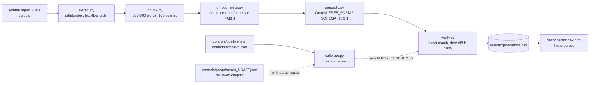
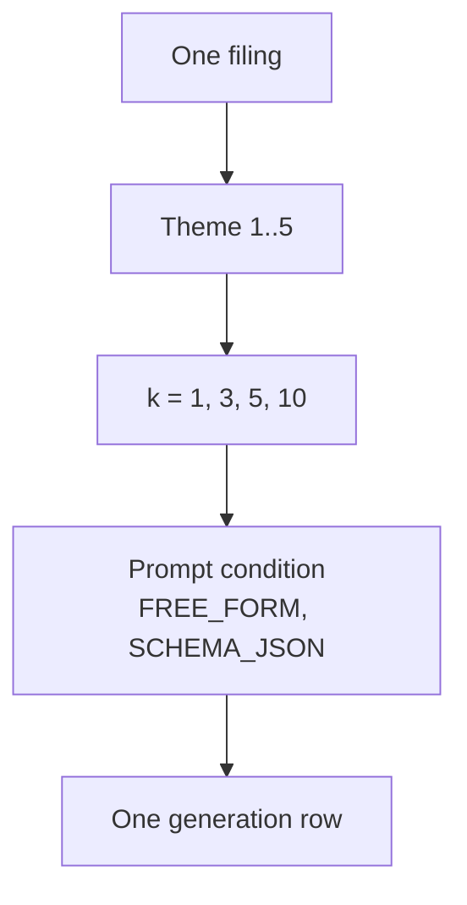
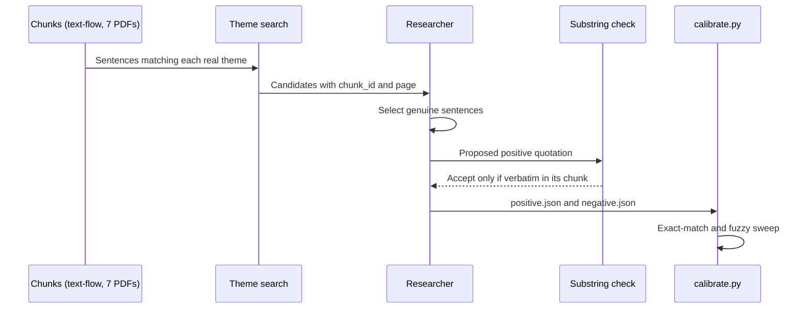
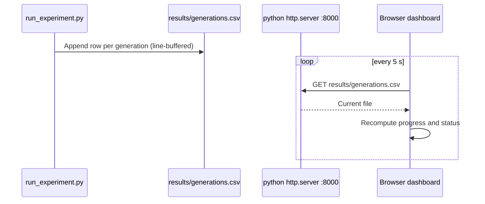

# Quotation-Fidelity Pipeline: Build Process, Decisions, and Status

Status date: 2026-10-17. This is a process and status report. The experiment has not yet produced results, so no fabrication rates or verifier accuracy figures are reported here. The calibration figures in Section 8a are control-set measurements, not experimental results.

## 1. Purpose

The study asks whether a language model, given excerpts from Indian annual reports, produces verbatim quotations that actually appear in the source, and how often it fabricates them. The pipeline is a standalone research version of the grounding guard planned for the production Filing Analyst Agent (RedShift SRS/SDS v9, Component 3; FR-31). Measurements from this study are meant to set the verifier threshold used in production.

## 2. Experimental design (as planned)

| Element | Plan | Notes |
|---|---|---|
| Companies | Up to 15 | Corpus has seven PDFs; five are usable (Section 4) |
| Themes | 5 | auditor qualifications and emphases of matter; related-party transactions; promoter share pledging; going-concern disclosures; contingent liabilities and guarantees |
| Retrieval depth k | 1, 3, 5, 10 | |
| Prompt conditions | 2 | FREE_FORM and SCHEMA_JSON |
| Generations | up to 600 | With the five usable filings the grid is 5 x 5 x 4 x 2 = 200 |
| Verifier | Fuzzy matching, threshold 0.80 | Chosen from the calibration sweep on the control sets (Section 8a). Not a validated constant. Does not reliably accept real paraphrases |

Decision: the grid is scaled to the filings actually available (200 generations, from Yes Bank, IL&FS, Infosys, TCS and HUL), not padded to 600. DHFL and Manpasand are excluded until their files are replaced (Section 4). Reducing the company count changes the power of the crisis-versus-control comparison and must be stated in the paper.

## 3. Environment

- Machine: Apple M3 (arm64), macOS 26.5.2. Python 3.11.15 in a project virtualenv (`venv/`), standardised on 2026-10-17. The earlier 3.9.6 venv is archived and no longer used.
- Dependencies: pdfplumber, sentence-transformers, faiss-cpu, google-genai (see `requirements.txt` and the lock file in Section 13.3).
- Model access: Gemini API key set through a local `.env` file, not committed.
- Decision: heavy steps (embedding, FAISS, generation) run on the researcher's own machine, not in a cloud sandbox, because the sandbox could not install the packages or reach PyPI.

Known risks and their state (2026-10-17):
- Python version: standardised on 3.11.15, which matches the cached bytecode. The offline tests and the smoke test pass under 3.11. The full calibration sweep, the chunk counts and the extraction flips were produced under 3.9.6 and have not been re-run under 3.11 (Section 13.3).
- SDK: `generate.py` now uses `google-genai`. The deprecated `google-generativeai` package is no longer used. The migrated client has no live API call yet; its request shape and retry loop are tested offline (`tests/test_generate.py`).
- Fuzzy matching: `difflib` is kept, not `rapidfuzz`. This is a stated limitation (Section 7).

### Figure 1. Pipeline stages



Status: A, B, C, F, H built and run on the corpus. D, E untested. I, J built and run on the current controls. K reviewed 2026-10-17.

### Figure 2. Experiment grid per filing



Each filing contributes 5 x 4 x 2 = 40 rows. Five filings give the 200-row expected total used by the dashboard.

### Figure 3. Control-set build and verification



### Figure 4. Monitoring path during a run



## 4. Corpus

Seven annual-report PDFs are in `corpus/`. Five are usable. Fiscal years follow the plan: each crisis company is taken at the last report before its public crisis; clean controls use the most recent report.

| Company | Role | Fiscal year used | File | Status |
|---|---|---|---|---|
| Yes Bank | Crisis | FY2020 | yes-bank-fy2020.pdf | Usable |
| DHFL | Crisis | FY2019 (label) | dhfl-fy2019.pdf | **Excluded**: the file is the 2017-18 report |
| IL&FS | Crisis | FY2018 | ilfs-fy2018.pdf | Usable; fiscal year confirmed from the body text (year ended 31 March 2018) |
| Manpasand Beverages | Crisis | FY2018 | manpasand-fy2018.pdf | **Excluded**: partial text layer |
| Infosys | Control | FY2025 | infosys-fy2025.pdf | Usable |
| TCS | Control | latest (FY2026) | tcs-latest.pdf | Usable |
| HUL | Control | latest (FY2026) | hul-latest.pdf | Usable |

Decisions and open issues:
- Manpasand FY2018 was kept over the later FY2020 report. Using a post-crisis report would break the design, since the crisis companies' pre-crisis disclosures are the comparison baseline.
- Cover-page check (2026-10-14), from page 1 of each file:
  - Yes Bank: exchange letter dated 17 August 2020 for the 2019-20 report. Consistent with FY2020.
  - Infosys: Integrated Annual Report 2024-25. Consistent with FY2025.
  - TCS: Integrated Annual Report 2025-26, labelled "latest". Consistent.
  - HUL: Integrated Annual Report 2025-26, labelled "latest". Consistent.
  - IL&FS: "Annual Report 2018" on the cover. The body text states the year ended 31 March 2018 (FY 2017-18), with 2017 as comparative (directors' report, balance sheet "as at March 31, 2018", and P&L and cash-flow headings; checked 2026-10-17 by text search, page numbers as extracted from the PDF). The "March 31, 2019" hits are RBI deadlines and plans, not year-ends. No separate auditor's report heading was found in the text layer, so the auditor's report was not checked directly.
  - DHFL: the file is the **Annual Report 2017-18**, not FY2019 as labelled. The file must be replaced with the 2018-19 report, or the label and the design must be changed.
  - Manpasand: page 1 is a 17 September 2018 exchange filing letter, not the annual report. Of 131 pages, 12 are blank, and some are image-only, so the text layer is partial. The source must be replaced with a text-based annual report.
- Infosys is labelled FY2025 by its filename. The "latest" labels for TCS and HUL are not yet tied to a specific year.
- Filing count: the earlier plan and the dashboard assumed seven filings (280 generations). The manifest now lists five, so the target is 200. This is a reduction in the company count and is stated as a limitation.

## 5. Process: planned versus actual

| Stage | Planned (runbook) | What was done | Status |
|---|---|---|---|
| 0. Setup | Unpack, venv, install, API key | Unpacked to `~/quotation-fidelity`; venv created; dependencies installed; key active | Done |
| Version control | Not specified | Commits on `main` through `eabe42f`. Round of changes dated 2026-10-17 partly uncommitted (Section 12) | Partial |
| 1. Corpus | Download 7 PDFs; verify fiscal years | All 7 downloaded; cover pages checked; five usable | Done with exclusions |
| 2. Extraction sanity check | Run extract and chunk on one PDF | All seven re-extracted with text-flow order on 2026-10-17 | Done |
| 3. Controls (manual) | Hand-copy 20+ genuine sentences and 20+ absent ones | Stopped at 17 positive (abstract commits to 20; shortfall stated, Section 8), 20 negative | Done, with shortfall |
| 4. Calibration | Run `calibrate.py`; set threshold from the sweep | Run on the current controls (Section 8a); threshold 0.80 | Done, with limits |
| 4b. Retrieval check | Recall@k with and without the 200-word limit | Quote-as-query recall run (Section 6). Gold chunk in top 10 for 3 of 17 positives. The explicit with/without comparison not run | Partial |
| 5. Dry run | 1 filing, check the row format | Not run; `embed_index.py` and `generate.py` are untested | Blocked |
| 6. Full run | About 200 generations (five filings) | Not run. The 25 rows generated before 2026-10-17 used the old chunks and must be moved aside | Pending |
| 7. Adversarial test and labelling | Steered copies; two annotators; kappa | Not started. The adversarial variant is not in the code | Pending |
| 8. Paper | Full paper from real numbers | This document is the process report only | Pending |

## 6. Measured results so far

Extraction and chunking use the project's own `extract.py` and `chunk.py`: text-flow page extraction (`use_text_flow=True`), and chunks of 500 to 800 whitespace-delimited words with 100-word overlap. The counts below are from the text-flow run of 2026-10-17. They replace an earlier default-extraction run, whose chunk counts and chunk IDs are not valid.

| Filing | Pages | Chunks (text-flow) | Chunks (earlier default run) | Extractable |
|---|---|---|---|---|
| Infosys FY2025 | 369 | 261 | 257 | Yes |
| TCS latest | 360 | 276 | 243 | Yes |
| HUL latest | 244 | 302 | 294 | Yes |
| Yes Bank FY2020 | 359 | 297 | 299 | Yes |
| IL&FS FY2018 | 334 | 135 | 135 | Yes |
| DHFL FY2019 | 266 | 204 | 189 | Yes |
| Manpasand FY2018 | 131 | 19 | 18 | Yes |
| **Total** | **2,063** | **1,494** | **1,435** | |

Why extraction order matters. The default extractor orders text by position on the page. On two-column layouts this interleaves the two columns, so a sentence that wraps across the columns is split by text from the other column. Two genuine sentences checked on 2026-10-17 were scored as fabrications under the default order (Infosys, Annexure 7, PDF page 66: PURE_FABRICATION, score 0.676; Yes Bank, Social section, PDF page 69: PURE_FABRICATION, score 0.399). Under text-flow order both are EXACT_MATCH with score 1.0. Without this change the pipeline would count genuine quotations that span a column break as fabrications, which would inflate the fabrication rate the study measures.

Flip count (2026-10-17, substring match over all five usable filings, `normalise` applied). Default order matches 15 of the 17 positives; text-flow matches all 17. The two flips are the two sentences added on the same day, both in the default-miss direction. No quotation flips in the other direction, and no negative control matches under either order, so text-flow adds no false positives on these controls. The 26 paraphrases match under neither order, because they are paraphrases by design. The paraphrase group therefore adds no signal to this comparison.

Text quality, separate from the `extractable` flag: the text layers of the crisis filings (Yes Bank, DHFL, IL&FS, Manpasand) carry sidebar labels and table cells in the body text. Text-flow order keeps running sentences contiguous but does not remove sidebar text. Sentence-level search on those filings returns fewer clean sentences than on the clean-control filings.

Concern: Manpasand gives 19 chunks from 131 pages, about a fifth of the chunk density of the other filings. Either the text layer is sparse (scanned or image-heavy pages) or extraction is losing text. The `extractable` flag only tests average characters per page, so it does not catch partial extraction. Manpasand is excluded from the manifest for this reason.

### Retrieval check (quotation as query)

One FAISS index over the 1,494 text-flow chunks, with `all-MiniLM-L6-v2` embeddings and inner-product search on normalised vectors. The query is each positive quotation. A hit is the gold chunk ID appearing in the top k. All 17 gold chunks are in the index.

| k | Hits (of 17) | Recall |
|---|---|---|
| 1 | 1 | 0.059 |
| 3 | 2 | 0.118 |
| 5 | 2 | 0.118 |
| 10 | 3 | 0.176 |

Result. With the quotation as the query, the gold chunk is in the top 10 for only 3 of 17 positives. A low recall means the generator may never see the chunk a quotation came from, which limits what the study can test.

Caveat. The production queries are the five theme queries, not the quotations. The quote-as-query experiment measures something else, so the 3 of 17 figure cannot be generalised to the pipeline.

Truncation. The embedder already truncates silently. `all-MiniLM-L6-v2` has a maximum sequence length of 256 word pieces (checked 2026-10-17), which is about 200 words. Each 500–800-word chunk is therefore embedded only through its first part. The explicit comparison with and without this limit has not been run. A scratch run with a 200-word cut and with no cut gave identical recall, but both passed through the embedder's own 256-piece limit, so that run does not measure the effect of the cut. The pipeline has no separate truncation step, and none has been added.

## 7. Verifier

- `verify.py` uses Python's standard `difflib`. `rapidfuzz` was planned but could not be installed in the build environment. The threshold does not transfer between the two libraries, so the calibration must be run on the library actually used.
- `normalise()` applies NFKC normalisation, collapses whitespace, unifies quote marks, and rejoins hyphenated line-wrap breaks.
- Decision (2026-10-17): keep `difflib`. Switching to `rapidfuzz` would change the fuzzy scores and so require recalibrating `FUZZY_THRESHOLD`, and the sweep in Section 8a would have to be re-run and re-reported. Limitation: the fuzzy scores and the 0.80 threshold are specific to `difflib.SequenceMatcher`.
- Smoke tests: 4 of 4 pass (2026-10-17).
- `FUZZY_THRESHOLD = 0.80`. See Section 8a for the basis and its limits.
- Overlap rule (2026-10-17). Adjacent chunks share a 100-word overlap, so a quotation inside the overlap matches two chunks. Both stages check the claimed chunk first. A match on the claimed chunk is EXACT_MATCH or FUZZY_MATCH on that chunk. Only if the claimed chunk does not match is another supplied chunk checked, which gives PROVENANCE_MISMATCH. If nothing matches, the result is PURE_FABRICATION. Eight unit tests in `tests/test_overlap.py` cover the overlap cases; all pass. The sweep in Section 8a supplies only the claimed chunk, so its numbers do not depend on this rule.

## 8. Control sets

Two process errors occurred here and are recorded in full.

1. Themes. The quotation-finder script (`src/find_quotations.py`) and the first control templates were built around themes I had invented (revenue growth, revenue decline, asset quality, regulatory breach, cash-flow pressure). These do not match the experiment's themes in `src/generate.py`. The suggestions from that script must be discarded.
2. Search quality. Keyword regular expressions over PDF text returned mostly table-of-contents lines, headers, and fragments. It is not a usable source of control sentences without manual checking.

Corrected approach:

1. All seven filings were chunked with the pipeline's own code. The current chunks use text-flow order (1,494 chunks).
2. Each of the five real themes was searched across the chunks, first with broad patterns, then with stricter filters (no table-like digit runs, no page-header vocabulary, length 80 to 220 characters).
3. Positive controls are sentences copied verbatim from a named chunk. Each must match its chunk exactly under the current extraction. All 17 current positives pass.
4. Negative controls are plausible financial-audit sentences. Each must be absent from the normalised text of all seven filings. All 20 pass.
5. `verify.verify_quotation` was run on each control against its own chunk. All 17 positives return EXACT_MATCH and all 20 negatives return PURE_FABRICATION.

Changes to the positive set on 2026-10-17, after the text-flow switch:
- 14 positives were remapped to the chunk IDs that contain their quotes under text-flow order. Chunk numbers had shifted.
- The two DHFL positives were removed. They cited `DHFL_2019_c0156`, which is in the 2017-18 report.
- One HUL positive (the garbled pledging sentence) was removed because no chunk contains it.
- Two sentences were added, both tagged as outside the five study themes: the Infosys resource-conservation sentence (`Infosys_2025_c0053`, Annexure, PDF page 66) and the Yes Bank group-capabilities sentence (`Yes Bank_2020_c0044`, Social section, PDF page 69).

Results of the control set:

| Theme | Positives | Negatives |
|---|---|---|
| Auditor qualifications and emphases of matter | 4 | 4 |
| Related-party transactions | 4 | 4 |
| Promoter share pledging | 1 | 4 |
| Going-concern disclosures | 4 | 4 |
| Contingent liabilities and guarantees | 2 | 4 |
| Outside the five themes | 2 | 0 |
| Total | 17 | 20 |

By company, the 17 positives are Infosys 11, HUL 2, TCS 2 and Yes Bank 2. None come from DHFL.

Shortfalls and caveats:
- **The study stops at 17 positive controls. The abstract commits to 20; that commitment is not met, and this is a stated shortfall.** The decision was made on 2026-10-17 to stop rather than add controls. On the same date the calibration guard was lowered from 20 to 15 (`MIN_POSITIVE` in `src/calibrate.py`) so that calibration can run. The abstract's figure of 20 is not met, and the paper must say so.
- Pledging has one positive, and it is weak. The earlier pledging examples were garbled passages and one was removed. The remaining entry is a boilerplate clause and is not a clean test of a pledging disclosure.
- Crisis-company coverage is now two positives, both from Yes Bank. DHFL has none. The planned balance across the crisis companies is not achieved.
- Negatives are written by hand and vary in how far they sit from real language. Their difficulty has not been measured.

## 8a. Calibration

`calibrate.py` was run on the current controls (17 positives, 20 negatives) on 2026-10-17. Two sweeps were run: the mechanical sweep (word swap and clause drop, two per positive, 34 degraded cases), and the mechanical sweep plus the reviewed paraphrases (34 mechanical plus 26 paraphrases, 60 degraded cases). The 26 paraphrases are the reviewed `keep` and `fix` entries whose source control is still in the set. Five further `keep` or `fix` paraphrases were dropped because their source controls were removed.

Mechanical sweep only (34 degraded positives, 20 negatives):

| Threshold | Degraded positives accepted | Degraded positives rejected | Negatives accepted (of 20) |
|---|---|---|---|
| 0.70 | 34 | 0 | 1 |
| 0.75 | 34 | 0 | 1 |
| 0.80 | 34 | 0 | 0 |
| 0.85 | 34 | 0 | 0 |
| 0.90 | 29 | 5 | 0 |
| 0.95 | 22 | 12 | 0 |

With reviewed paraphrases added (26 paraphrases; the mechanical 34 are the same as above, so the paraphrase acceptances are the difference):

| Threshold | Paraphrases accepted (of 26) | Negatives accepted (of 20) |
|---|---|---|
| 0.70 | 9 | 1 |
| 0.75 | 6 | 1 |
| 0.80 | 2 | 0 |
| 0.85 | 0 | 0 |
| 0.90 | 0 | 0 |
| 0.95 | 0 | 0 |

Gap in the calibration method: the sweep measures how many degraded positives each threshold accepts. It does not measure how many fabricated quotations each threshold accepts, so the threshold cannot be justified by the sweep alone. The fabrication side was checked by reading each negative's match score from the verifier:

- Highest negative score: 0.759, for "Management has concluded that a material uncertainty exists which casts significant doubt on the company's ability to continue as a going concern."
- Next highest: 0.655. All other negatives score below 0.55.

Threshold justification. The rule is the lowest tested threshold with no negative control accepted. At 0.70 and 0.75 one negative (score 0.759) is accepted. At 0.80 no negative is accepted, and all 34 mechanical degraded positives are accepted. So 0.80 is the lowest tested threshold that meets the rule, with a margin of 0.041 below the closest negative. The threshold is set to 0.80 in `verify.py`.

Scope limit: the rule is met on mechanical degradation only. At 0.80, 2 of 26 reviewed real paraphrases are accepted (24 rejected). The threshold therefore handles extraction noise and word-level edits. It does not reliably accept paraphrases at any tested threshold without also accepting the 0.759 negative. For a verbatim-quotation study, rejecting most paraphrases is the intended behaviour, but the paper must state the scope and must not describe the 0.80 result as validated for paraphrase.

Limitation: the threshold was chosen on the same control sets it is reported on, so it is not a validated constant. The margin is thin (0.041, against a 0.759 score).

Held-out stability check (`heldout_check.py`, seed 42, stratified by theme). Calibration half: 8 positives, 10 negatives. Held-out half: 9 positives, 10 negatives. At 0.80: original positives 9 of 9 accepted, degraded positives 18 of 18 accepted, negatives 0 of 10 accepted. The check uses the same controls the threshold was chosen on, so it is a stability check only. A fair test needs controls written after the threshold was fixed.

## 8b. Control-set limitations

- **The positive set has 17 entries, not the 20 committed to in the abstract. This is a stated shortfall. The study stops at 17.** The calibration guard was lowered to 15 on 2026-10-17 to allow calibration to run.
- Pledging has one positive, and it is weak.
- Both crisis-company positives come from Yes Bank. None come from DHFL or IL&FS or Manpasand.
- Two positives are outside the five study themes and are kept for extraction checks only.
- Negatives are hand-written. Their difficulty relative to real disclosures has not been measured.
- The paraphrase set was machine-drafted and then reviewed by the researcher. Five reviewed paraphrases were dropped because their source controls were removed.

## 9. Monitoring

- `run_experiment.py` writes one CSV row per generation to `results/generations.csv`. The file is line-buffered so progress is visible during a run.
- `dashboard/index.html` reads that CSV every 5 seconds and shows progress against the expected 200 generations (five filings, 40 each), per-filing counts, verification outcomes, and the latest rows. It is served locally on port 8000 by `python3 -m http.server`.
- Status logic: "Running" if a new row appeared in the last 2 minutes, "Quiet" after 2 minutes, "Stalled" after 10 minutes with no new row.
- The dashboard was checked for CSV parsing and serving. It has not been viewed in a browser.

## 10. Issues and corrections log

| # | Issue | Effect | Resolution |
|---|---|---|---|
| 1 | Runbook PDF (Desktop and home folder) was written from assumptions, not from the code. It lists CLI flags that do not exist (`--output`, `--dry-run`, `--resume`, `--preview`) and placeholder results. | Misleading if followed | Do not use. `RUNBOOK.md` in the project is authoritative. |
| 2 | First `extract.py` call used a non-existent `--output` flag. | Command failed | Used the real signature: `extract.py <pdf> <company> <fy>` |
| 3 | Wrong themes in suggestions and control templates. | Controls would test the wrong concepts | Rebuilt around the five real themes |
| 4 | Chunking script referenced a shell variable inside Python. | Crash after roughly 10 minutes of work with no output saved | Path fixed and job rerun |
| 5 | Keyword search over PDF text produced mostly noise. | Unusable suggestions | Replaced by search over pipeline chunks with programmatic verification |
| 6 | Manpasand chunk density is about a fifth of the others. | Possible extraction loss | Open. Manpasand excluded from the manifest. |
| 7 | Commit included compiled bytecode. | Repository clutter | Open. Add a `.gitignore`. |
| 8 | Commit used an older co-author attribution line. | Attribution inconsistency | Later commits use the current line. |
| 9 | Default extraction interleaves two-column text, so genuine quotations that span a column break were scored as fabrications (0.676 and 0.399). | Would inflate the fabrication rate | Fixed: `extract.py` uses text-flow order (commit `68f849b`). |
| 10 | Text-flow extraction renumbered chunks. Earlier chunk IDs in the controls and the 25 generation rows no longer match. | Control chunk IDs and generation rows point at the wrong chunks | Controls remapped and verified. Generation rows must be moved aside and re-run. |
| 11 | DHFL positives cited the 2017-18 report, and one HUL positive could not be matched after re-extraction. | Controls drawn from a file that must not be used | Removed. |
| 12 | Calibration guard required 20 positives; the set has 17. | Calibration refused to run | Guard lowered to 15 (`MIN_POSITIVE`). The study stops at 17 positives; the abstract's 20 is not met and is stated in Sections 8 and 8b. |
| 13 | Paraphrases were matched to controls by list index. Removing controls shifted the indices, and the sweep crashed. | Wrong source sentence for paraphrases; crash | Paraphrases now store `source_quotation` and are matched by text. Paraphrases whose source was removed are skipped and counted. |
| 14 | Real paraphrases mostly fail at 0.80 (2 of 26 accepted). The earlier 0.80 justification covered mechanical degradation only. | Threshold must not be described as validated for paraphrase | Scope limit stated in Section 8a. |
| 15 | Threshold and count text was stale across the documents and scripts (0.85 placeholder, 280 generations, seven filings, 20 positives). | Inconsistent documents | Updated in this paper, `RUNBOOK.md`, `README.md`, `controls/README.md`, `dashboard/index.html`, and the script comments. |
| 16 | The embedder truncates silently at its 256-word-piece limit (about 200 words), so only the first part of each 500–800-word chunk is embedded. | Retrieval may ignore the rest of each chunk | Recorded here. The explicit with/without comparison has not been run. No truncation step has been added to the pipeline. |
| 17 | Overlap fault: the exact stage returned the first chunk containing a quotation, and the fuzzy stage chose the best-scoring chunk, so a quotation in a chunk overlap could be labelled PROVENANCE_MISMATCH. | Wrong provenance label | Both stages now check the claimed chunk first. Eight unit tests cover the overlap cases. |
| 18 | Quote-as-query recall is low: the gold chunk is in the top 10 for 3 of 17 positives. | Limits what the generator can be shown | Recorded in Section 6, with the caveat that production queries are theme queries. |

## 11. Open items before the first experimental run

1. Positive controls stop at 17 (decision of 2026-10-17). The shortfall against the abstract's 20 is stated in Sections 8 and 8b. Pledging and crisis-company coverage remain weak and are limitations of the study.
2. Replace the DHFL file with the 2018-19 report, or exclude DHFL from the design permanently. Replace or fix the Manpasand file, or exclude it permanently.
3. Re-examine `FUZZY_THRESHOLD` (0.80; Section 8a) once a control set exists that was not used to choose it.
4. Move `results/generations.csv` aside before the first run after 2026-10-17, since its rows were generated against the old chunks.
5. Run a 1-filing dry run and read the CSV before spending the full quota.
6. Decide whether to migrate to `google-genai` before the full run.
7. Build the adversarial-authorship variant, or drop it from the plan and say so in the paper.
8. Commit the working state with a `.gitignore` for `venv/`, `__pycache__/`, `.env`, and `corpus/`.

## 12. Development log

| Date | Change | Files |
|---|---|---|
| 2026-10-01 | Pipeline code built in a cloud session and delivered as an archive | quotation-fidelity.tar.gz |
| 2026-10-14 | Archive unpacked to `~/quotation-fidelity`; git initialised (commit 345a216) | all |
| 2026-10-14 | Virtualenv created; dependencies installed; Gemini key active | venv/, requirements.txt |
| 2026-10-14 | Seven PDFs downloaded to `corpus/` | corpus/ |
| 2026-10-14 | Infosys extracted and chunked under default extraction | src/extract.py, src/chunk.py |
| 2026-10-14 | Quotation-finder script written, then found to use wrong themes and produce noise; suggestions discarded | src/find_quotations.py |
| 2026-10-14 | Live dashboard added; run_experiment.py switched to line-buffered output | dashboard/index.html, src/run_experiment.py |
| 2026-10-14 | All seven filings chunked (default extraction); 18 positive and 20 negative controls written and verified | controls/positive.json, controls/negative.json |
| 2026-10-14 | calibrate.py run; fuzzy sweep recorded; negative scores read separately | docs/technical-paper.md Section 8a |
| 2026-10-14 | Infosys dry run started. Failures fixed: API key loading, model retirement (gemini-1.5-pro, then gemini-2.5-flash, now gemini-3.8-flash), embedding model loaded per call, per-minute quota throttling | src/run_experiment.py, src/embed_index.py, src/generate.py |
| 2026-10-14 | Free-tier daily quota (20 requests per day) exhausted; generation proceeds in daily batches | none |
| 2026-10-14 | Cover-page check of the corpus: DHFL file is FY2017-18, Manpasand file is a filing letter with a partial text layer | docs/technical-paper.md Section 4 |
| 2026-10-14 | calibrate.py reports negative-control acceptance at each threshold | src/calibrate.py |
| 2026-10-15 | `run_experiment.py` appends and skips recorded generations; daily-quota error exits with code 3 | src/run_experiment.py |
| 2026-10-17 | Paraphrase review recorded: 29 keep, 2 fix, 5 reject. Review merged to `main` via PR #1 (`c955b2d`) | controls/paraphrases_DRAFT.json, controls/paraphrases_REVIEW.md |
| 2026-10-17 | Threshold 0.80 justified in Section 8a with the scope limit; placeholder 0.85 references removed | docs/technical-paper.md, src/verify.py |
| 2026-10-17 | Expected generation count set to 200 for the five-filing manifest; ILFS fiscal year confirmed as FY2018 from the body text | dashboard/index.html, RUNBOOK.md, README.md |
| 2026-10-17 | `extract.py` switched to text-flow order; all seven PDFs re-extracted and re-chunked (1,494 chunks). Committed and pushed (`68f849b`) | src/extract.py |
| 2026-10-17 | Opt-in `--with-paraphrases` flag added to `calibrate.py` (commit `eabe42f`, pushed) | src/calibrate.py |
| 2026-10-17 | Positive controls remapped to text-flow chunks; DHFL and one unmatched HUL positive removed; two sentences added. Verified against own chunks | controls/positive.json |
| 2026-10-17 | Calibration guard lowered to 15 positives (`MIN_POSITIVE`). Paraphrase source matching changed from index to text (`source_quotation`) after the sweep crashed | src/calibrate.py, controls/paraphrases_DRAFT.json |
| 2026-10-17 | Calibration sweeps and held-out check re-run on the current controls (Section 8a). Docs and script comments updated | docs/technical-paper.md, RUNBOOK.md, README.md, controls/README.md, src/verify.py, src/run_experiment.py |
| 2026-10-17 | Overlap rule: the claimed chunk is checked first at both the exact and the fuzzy stage; eight unit tests added (`tests/test_overlap.py`) | src/verify.py, tests/test_overlap.py |
| 2026-10-17 | Retrieval (quotation as query) run: 3 of 17 positives in the top 10. Truncation gap recorded; no truncation step added | docs/technical-paper.md Sections 5, 6, 10 |
| 2026-10-17 | Decision: the positive control set stops at 17. The abstract's commitment to 20 is stated as a shortfall in the paper, not closed by adding controls | docs/technical-paper.md |

Changes made on 2026-10-17 after commit `eabe42f` are not committed at the time of writing. They are listed in the working tree.

Diagrams are Mermaid blocks. They render in GitHub, in VS Code's Markdown preview with a Mermaid extension, and in most Markdown tools that support Mermaid. Plain-text viewers show the source.

## 13. Reproducibility

### 13.1 Code and data versions

- Calibration sweeps and the held-out check were run on `origin/main` at commit `abb418e` (checked out in a separate worktree). The verifier overlap change (Section 7) was made after that commit and has not been committed; its unit tests pass and its smoke test passes 4/4.
- The control files are the 17 positives and 20 negatives in `controls/`, plus the 36 paraphrases in `controls/paraphrases_DRAFT.json`. Using the paraphrase file reduces to 26 usable entries (`keep` or `fix`, with the source control still present).
- The corpus PDFs are git-ignored. SHA-256 digests of the five usable PDFs, computed on 2026-10-17 with `shasum -a 256`, are below. The two excluded PDFs (DHFL and Manpasand) are not listed.

| File | SHA-256 | Size (bytes) |
|---|---|---|
| infosys-fy2025.pdf | `a2b9acdfbe79586ffdbe1780c4f14e5b2630743a4c81ee626f812f4c2fff1b44` | 7,010,611 |
| tcs-latest.pdf | `a19bddbe9cfd136de02fbd266335034a31d507efe790dfec0241be9aa0b0a5a0` | 22,126,348 |
| hul-latest.pdf | `98219f80b28472d4d11c893274e0537b5098c98f34dcc30c7f905db3cb7a929b` | 30,641,303 |
| yes-bank-fy2020.pdf | `3ad2f51f9660d3415e0a9bb1a8cc61aac16c0b0f1a894fdacdd68aa754ad7e16` | 14,441,184 |
| ilfs-fy2018.pdf | `7d630986aad46a2c60bc9502d310b32c5150920c4429a7b18c64fb978bac4b2d` | 5,762,316 |

A repeat of the study should check these digests before extraction. A mismatch means the file is not the one used here.

### 13.2 Random seeds

- `calibrate.py` uses `random.Random(42)` for the mechanical degradations (word swap and clause drop). The paraphrase sweep is deterministic given the file.
- `heldout_check.py` uses `SEED = 42` for the stratified split and `random.Random(SEED)` for the degradation step.
- The verifier, the chunker and the extractor have no random steps.
- The generation step (`generate.py`, Gemini) has no seed set. Model output is not reproducible from the seed; the grid's rows are the record.

### 13.3 Environment

Standardised on 2026-10-17: Python 3.11.15 in `venv/`, created with `uv venv --python 3.11`. The full package list is in `requirements.lock.txt` (67 packages, from `uv pip freeze`). `requirements.txt` gives minimum versions, so the lock file is the record of what was installed.

| Item | Value (current venv) |
|---|---|
| Machine | Apple M3 (arm64), macOS 26.5.2 (build 25F84) |
| Python | 3.11.15 (`uv`-managed CPython) |
| Shell | zsh |
| pdfplumber | 0.11.10 (pdfminer.six and pypdfium2 per the lock file) |
| google-genai | 2.31.0 (replaces the deprecated google-generativeai) |
| sentence-transformers | 6.1.0 (torch 2.14.1, transformers 5.20.1, tokenizers 0.23.3) |
| faiss-cpu | 1.15.1 |
| numpy | 2.4.6 |
| Standard library | `difflib` for fuzzy matching (rapidfuzz not installed) |
| Embedding model | `all-MiniLM-L6-v2`, maximum sequence length 256 word pieces (checked on 3.9 with sentence-transformers 5.1.2), loaded with `local_files_only` |

Earlier results were produced in a different environment, and they are not re-run under this one unless stated:
- The calibration sweeps (Section 8a) and the held-out check were run on `origin/main` (`abb418e`) in the Python 3.9.6 venv, with pdfplumber 0.11.8. The verifier uses only the standard library, so the sweep numbers do not depend on those packages, but this has not been confirmed under 3.11.
- The chunk counts in Section 6 and the flip counts in Section 6 were produced with pdfplumber 0.11.8. pdfplumber 0.11.10 may extract slightly differently, so the chunk counts need re-checking under the new environment before the full run.
- The retrieval check (Section 6) was run with sentence-transformers 5.1.2 in the 3.9 venv.
- The offline tests (`tests/test_overlap.py`, `tests/test_generate.py`, 14 tests in total) and the verifier smoke test (4/4) were run under 3.11.15 and pass.

### 13.4 How to repeat the calibration

```bash
git checkout abb418e
cd src
../venv/bin/python calibrate.py                    # mechanical sweep, thresholds 0.70-0.95
../venv/bin/python calibrate.py --with-paraphrases # with the 26 reviewed paraphrases
../venv/bin/python heldout_check.py                # stability check at 0.80
../venv/bin/python verify.py                       # 4/4 smoke tests
cd ..
./venv/bin/python -m unittest tests/test_overlap.py   # overlap rule, run from the repo root
```

The expected output is the tables in Section 8a. The full sweep takes several minutes per run.

### 13.5 Repeating the chunking

Chunking the five usable PDFs needs `corpus/` populated with the files named in Section 4. Run `src/chunk.py <pdf> <company> <fiscal_year>` for each, or use the extraction setting in `src/extract.py` (`use_text_flow=True`). The chunk counts in Section 6 are the check: 261, 276, 302, 297 and 135 for the five usable filings, and 204 and 19 for DHFL and Manpasand (excluded). The results from the full run must record the calibrated threshold, the control-set sizes (17 positive, 20 negative, 26 paraphrases), the extraction setting, and the library versions in Section 13.3.
