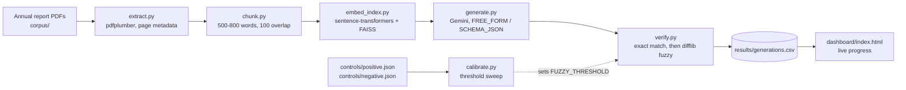
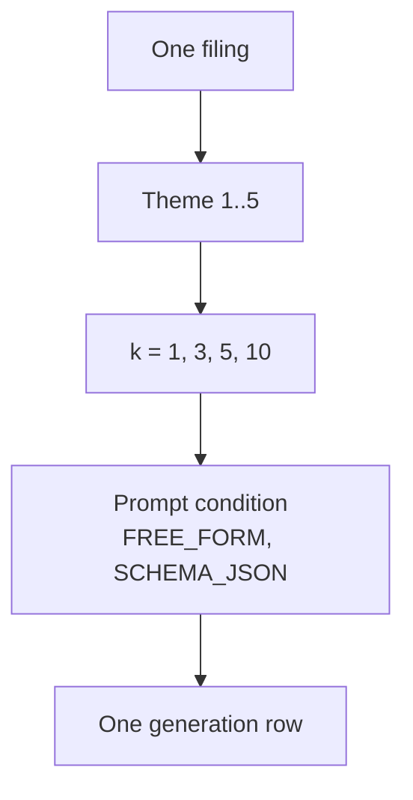
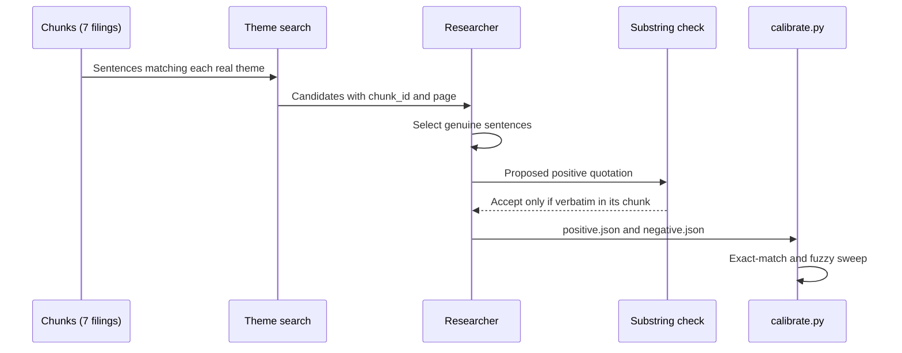
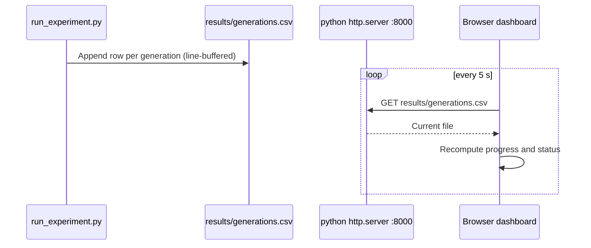

# Quotation-Fidelity Pipeline: Build Process, Decisions, and Status

Status date: 2026-10-14. This is a process and status report. The experiment has not yet produced results, so no fabrication rates or verifier accuracy figures are reported here.

## 1. Purpose

The study asks whether a language model, given excerpts from Indian annual reports, produces verbatim quotations that actually appear in the source, and how often it fabricates them. The pipeline is a standalone research version of the grounding guard planned for the production Filing Analyst Agent (RedShift SRS/SDS v9, Component 3; FR-31). Measurements from this study are meant to set the verifier threshold used in production.

## 2. Experimental design (as planned)

| Element | Plan | Notes |
|---|---|---|
| Companies | Up to 15 | Corpus delivered with 7 filings (see Section 4) |
| Themes | 5 | auditor qualifications and emphases of matter; related-party transactions; promoter share pledging; going-concern disclosures; contingent liabilities and guarantees |
| Retrieval depth k | 1, 3, 5, 10 | |
| Prompt conditions | 2 | FREE_FORM and SCHEMA_JSON |
| Generations | up to 600 | With the five usable filings in the manifest the grid is 5 x 5 x 4 x 2 = 200 |
| Verifier | Fuzzy matching, threshold chosen from calibration sweep | Threshold 0.80 (Section 8a). Chosen on the same controls it is reported on, so it is not a validated constant |

Decision: the grid is scaled to the filings actually available (200 generations, from Yes Bank, IL&FS, Infosys, TCS and HUL), not padded to 600. DHFL and Manpasand are excluded until their files are replaced (Section 4). Reducing the company count changes the power of the crisis-versus-control comparison and must be stated in the paper.

## 3. Environment

- Machine: macOS (Darwin 25.5.0), Python 3.9.6 in a project virtualenv (`venv/`).
- Dependencies: pdfplumber, sentence-transformers, faiss-cpu, google-generativeai (see `requirements.txt`).
- Model access: Gemini API key set through a local `.env` file, not committed.
- Decision: heavy steps (embedding, FAISS, generation) run on the researcher's own machine, not in a cloud sandbox, because the sandbox could not install the packages or reach PyPI.

Known risks:
- The bundled `__pycache__` files are cpython-311 builds, but the local interpreter is 3.9. The code has not yet been run under 3.9 end to end.
- `google-generativeai` is deprecated upstream in favour of `google-genai`. The migration is not done; generation results would need re-checking if the library changes.

### Figure 1. Pipeline stages

Status: A, B, C, F, H built. D, E untested. I, J blocked on hand-verified controls.

### Figure 2. Experiment grid per filing

Each filing contributes 5 x 4 x 2 = 40 rows. Five filings give the 200-row expected total used by the dashboard.

### Figure 3. Control-set build and verification

### Figure 4. Monitoring path during a run

## 4. Corpus

Seven annual reports, selected per the runbook. Fiscal years follow the plan: each crisis company is taken at the last report before its public crisis; clean controls use the most recent report.

| Company | Role | Fiscal year used | File | Source |
|---|---|---|---|---|
| Yes Bank | Crisis | FY2020 | yes-bank-fy2020.pdf | BSE archive |
| DHFL | Crisis | FY2019 | dhfl-fy2019.pdf | BSE archive |
| IL&FS | Crisis | FY2018 | ilfs-fy2018.pdf | Company site |
| Manpasand Beverages | Crisis | FY2018 | manpasand-fy2018.pdf | Trendlyne archive page, then the PDF |
| Infosys | Control | FY2025 | infosys-fy2025.pdf | Company site |
| TCS | Control | latest | tcs-latest.pdf | Company investor relations |
| HUL | Control | latest | hul-latest.pdf | Company investor relations |

Decisions and open issues:
- Manpasand FY2018 was kept over the later FY2020 report. Using a post-crisis report would break the design, since the crisis companies' pre-crisis disclosures are the comparison baseline.
- Cover-page check (2026-10-14), from page 1 of each file:
  - Yes Bank: exchange letter dated 17 August 2020 for the 2019-20 report. Consistent with FY2020.
  - Infosys: Integrated Annual Report 2024-25. Consistent with FY2025.
  - TCS: Integrated Annual Report 2025-26, labelled "latest". Consistent.
  - HUL: Integrated Annual Report 2025-26, labelled "latest". Consistent.
  - IL&FS: "Annual Report 2018" on the cover. Fiscal year confirmed as FY2018 by the researcher (2026-10-17).
  - DHFL: the file is the **Annual Report 2017-18**, not FY2019 as labelled. Mismatch. The file must be replaced with the 2018-19 report, or the label and the design must be changed.
  - Manpasand: page 1 is a 17 September 2018 exchange filing letter, not the annual report. Of 131 pages, 12 are blank, and some are image-only, so the text layer is partial. The source must be replaced with a text-based annual report.
- Infosys is labelled FY2025 by its filename. The "latest" labels for TCS and HUL are not yet tied to a specific year.

## 5. Process: planned versus actual

| Stage | Planned (runbook) | What was done | Status |
|---|---|---|---|
| 0. Setup | Unpack, venv, install, API key | Unpacked to `~/quotation-fidelity`; venv created; dependencies installed; key active | Done |
| Version control | Not specified | `git init` with one commit (345a216). The commit includes `__pycache__` files, which should be ignored. Later changes are uncommitted. | Partial |
| 1. Corpus | Download 7 PDFs; verify fiscal years | All 7 downloaded to `corpus/`; fiscal years not yet verified against cover pages | Partial |
| 2. Extraction sanity check | Run extract and chunk on one PDF | Infosys: 369 pages, extractable | Done |
| 3. Controls (manual) | Hand-copy 20+ genuine sentences and 20+ absent ones | Not done. Placeholder files exist and must be replaced. | Blocked |
| 4. Calibration | Run `calibrate.py`; set threshold from the sweep | Not run; needs real controls | Blocked |
| 5. Dry run | 1 filing, check the row format | Not run; `embed_index.py` and `generate.py` are untested | Blocked |
| 6. Full run | About 600 generations | Not run | Pending |
| 7. Adversarial test and labelling | Steered copies; two annotators; kappa | Not started | Pending |
| 8. Paper | Full paper from real numbers | This document is the process report only | Pending |

## 6. Measured results so far

Extraction and chunking use the project's own `extract.py` and `chunk.py` (chunks of 500 to 800 whitespace-delimited words, 100-word overlap).

| Filing | Pages | Chunks | Extractable |
|---|---|---|---|
| Infosys FY2025 | 369 | 257 | Yes |
| TCS latest | 360 | 243 | Yes |
| HUL latest | 244 | 294 | Yes |
| Yes Bank FY2020 | 359 | 299 | Yes |
| DHFL FY2019 | 266 | 189 | Yes |
| IL&FS FY2018 | 334 | 135 | Yes |
| Manpasand FY2018 | 131 | 18 | Yes |
| **Total** | **2,063** | **1,435** | |

Text quality, separate from the `extractable` flag: the text layers of the crisis filings (Yes Bank, DHFL, IL&FS, Manpasand) are heavily interleaved with page headers, sidebar labels, and table cells. Sentence-level search on those filings returned very few clean sentences, while the clean-control filings (Infosys, TCS, HUL) returned many. Because of this, the control sentences draw mostly on the clean-control filings.

Concern: Manpasand gives 18 chunks from 131 pages, about a fifth of the chunk density of the other filings. Either the text layer is sparse (scanned or image-heavy pages) or extraction is losing text. This must be checked against the PDF before the filing enters the experiment. Note that the `extractable` flag only tests average characters per page, so it does not catch partial extraction.

## 7. Verifier

- `verify.py` uses Python's standard `difflib`. `rapidfuzz` was planned but could not be installed in the build environment. The threshold does not transfer between the two libraries, so the calibration must be run on the library actually used.
- `normalise()` applies NFKC normalisation, collapses whitespace, unifies quote marks, and rejoins hyphenated line-wrap breaks.
- Smoke tests: 4 of 4 pass in the build environment.
- The fuzzy threshold is 0.80. It was chosen from the `calibrate.py` sweep on the control sets (Section 8a), and it is not a validated constant.

## 8. Control sets

Two process errors occurred here and are recorded in full.

1. Themes. The quotation-finder script (`src/find_quotations.py`) and the first control templates were built around themes I had invented (revenue growth, revenue decline, asset quality, regulatory breach, cash-flow pressure). These do not match the experiment's themes in `src/generate.py`. The suggestions from that script must be discarded.
2. Search quality. Keyword regular expressions over PDF text returned mostly table-of-contents lines, headers, and fragments. It is not a usable source of control sentences without manual checking.

Corrected approach, now complete for the first pass:

1. All seven filings were chunked with the pipeline's own code (1,435 chunks).
2. Each of the five real themes was searched across the chunks, first with broad patterns, then with stricter filters (no table-like digit runs, no page-header vocabulary, length 80 to 220 characters).
3. Positive controls are sentences copied from a named chunk. The build script checks each one as a verbatim substring of that chunk's normalised text. All 18 pass.
4. Negative controls are plausible financial-audit sentences. The build script checks each one as absent from the normalised text of all seven filings. All 20 pass.
5. `verify.verify_quotation` was run on each control against its own chunk. All 18 positives return EXACT_MATCH and all 20 negatives return PURE_FABRICATION.

Results of the control set:

| Theme | Positives | Negatives |
|---|---|---|
| Auditor qualifications and emphases of matter | 4 | 4 |
| Related-party transactions | 6 | 4 |
| Promoter share pledging | 2 | 4 |
| Going-concern disclosures | 4 | 4 |
| Contingent liabilities and guarantees | 2 | 4 |
| Total | 18 | 20 |

Shortfalls and caveats:
- The positive set is 2 short of the 20 committed to in the abstract.
- Pledging positives are weak. Both come from garbled passages. `HUL latest` reads "there has been no pledging of shares by the promoters/ s.", where the text layer lost part of the sentence. The TCS sentence is a boilerplate clause about shares held in demat form. Neither is a clean test of a pledging disclosure.
- Only two positives come from crisis companies (DHFL and Yes Bank). The planned balance across the seven companies is not achieved.
- Negatives are written by hand and vary in how far they sit from real language. Their difficulty has not been measured.
The earlier placeholder control files were replaced by these two files.

## 8a. Calibration

`calibrate.py` was run on the control sets. The exact-match check passed for all 18 positives and 20 negatives. The fuzzy sweep covered 36 degraded positives (word swap and clause drop, two per positive).

| Threshold | Degraded positives accepted | Degraded positives rejected |
|---|---|---|
| 0.70 | 36 | 0 |
| 0.75 | 36 | 0 |
| 0.80 | 34 | 2 |
| 0.85 | 33 | 3 |
| 0.90 | 27 | 9 |
| 0.95 | 18 | 18 |

Gap in the calibration method: the sweep measures only how many degraded positives each threshold accepts. It does not measure how many fabricated quotations each threshold accepts, so it cannot by itself justify a threshold. The fabrication side was checked separately, by reading each negative's match score from the verifier:

- Highest negative score: 0.759, for "Management has concluded that a material uncertainty exists which casts significant doubt on the company's ability to continue as a going concern."
- Next highest: 0.655. All other negatives score below 0.55.
- Lowest degraded-positive score that is a true match: 0.75 (two cases), then 0.845.

Consequences by threshold:

| Threshold | Negatives accepted (of 20) | Degraded positives accepted | Note |
|---|---|---|---|
| 0.70 | 1 | 36 of 36 | Accepts the 0.759 fabrication |
| 0.75 | 1 | 36 of 36 | Accepts the 0.759 fabrication |
| 0.80 | 0 | 34 of 36 | Recommended candidate: no negative accepted, 0.041 margin below the closest negative |
| 0.85 | 0 | 33 of 36 | Current placeholder; larger margin, fewer positives accepted |

Threshold justification. The rule is the lowest tested threshold with full specificity on the controls, meaning no negative control accepted. At 0.70 and 0.75 one negative (score 0.759) is accepted. At 0.80 no negative is accepted and 34 of 36 degraded positives are accepted. So 0.80 is the lowest tested threshold that meets the rule, with a margin of 0.041 below the closest negative. The threshold is set to 0.80 in `verify.py`, the value confirmed by the researcher (2026-10-14).

Limitation: the threshold was chosen on the same control sets it is reported on, so it is not a validated constant. The margin is thin (0.041, against a 0.759 score). Two checks remain before the value is treated as settled: paraphrase controls, which `calibrate.py` does not yet sweep, and a held-out control split, which `heldout_check.py` provides only as a stability check because its controls were used to pick the threshold. A fair test needs controls written after the threshold was fixed. The paper reports both the threshold and this margin.

## 8b. Control-set limitations

- The positive set is 2 short of the 20 committed to in the abstract.
- Pledging positives are weak. Both come from garbled passages. `HUL latest` reads "there has been no pledging of shares by the promoters/ s.", where the text layer lost part of the sentence. The TCS sentence is a boilerplate clause about shares held in demat form. Neither is a clean test of a pledging disclosure.
- Only two positives come from crisis companies (DHFL and Yes Bank).
- Negatives are hand-written. Their difficulty relative to real disclosures has not been measured.

## 9. Monitoring

- `run_experiment.py` writes one CSV row per generation to `results/generations.csv`. The file is now line-buffered so progress is visible during a run.
- `dashboard/index.html` reads that CSV every 5 seconds and shows progress against the expected 200 generations, per-filing counts, verification outcomes, and the latest rows. It is served locally on port 8000 by `python3 -m http.server`.
- Status logic: "Running" if a new row appeared in the last 2 minutes, "Quiet" after 2 minutes, "Stalled" after 10 minutes with no new row.
- The dashboard was checked for CSV parsing and serving. It has not been viewed in a browser.

## 10. Issues and corrections log

| # | Issue | Effect | Resolution |
|---|---|---|---|
| 1 | Runbook PDF (Desktop and home folder) was written from assumptions, not from the code. It lists CLI flags that do not exist (`--output`, `--dry-run`, `--resume`, `--preview`) and placeholder results. | Misleading if followed | Do not use. `RUNBOOK.md` in the project is authoritative. |
| 2 | First `extract.py` call used a non-existent `--output` flag. | Command failed | Used the real signature: `extract.py <pdf> <company> <fy>` |
| 3 | Wrong themes in suggestions and control templates. | Controls would test the wrong concepts | Rebuilt around the five real themes |
| 4 | Chunking script referenced a shell variable inside Python. | Crash after roughly 10 minutes of work with no output saved | Path fixed and job rerun |
| 5 | Keyword search over PDF text produced mostly noise. | Unusable suggestions | Replaced by search over pipeline chunks with programmatic verification |
| 6 | Manpasand chunk density is about a fifth of the others. | Possible extraction loss | Open. Check against PDF. |
| 7 | Commit included compiled bytecode. | Repository clutter | Open. Add a `.gitignore`. |
| 8 | Commit used an older co-author attribution line. | Attribution inconsistency | Later commits use the current line. |

## 11. Open items before the first experimental run

1. Verify each PDF's fiscal year on its cover page.
2. Investigate the Manpasand extraction gap.
3. Extend the positive controls to 20 (currently 18), with cleaner pledging examples and more crisis-company sentences. Fixing the Yes Bank, DHFL, IL&FS, and Manpasand text extraction is the likely route to crisis-company examples.
4. Re-examine `FUZZY_THRESHOLD` (set to 0.80, chosen on the control sets; Section 8a) once paraphrase controls and a held-out control split exist.
5. Run a 1-filing dry run and read the CSV before spending the full quota.
6. Decide whether to migrate to `google-genai` before the full run.
7. Commit the working state with a `.gitignore` for `venv/`, `__pycache__/`, `.env`, and `corpus/`.

## 12. Development log

| Date | Change | Files |
|---|---|---|
| 2026-10-01 | Pipeline code built in a cloud session and delivered as an archive | quotation-fidelity.tar.gz |
| 2026-10-14 | Archive unpacked to `~/quotation-fidelity`; git initialised (commit 345a216) | all |
| 2026-10-14 | Virtualenv created; dependencies installed; Gemini key active | venv/, requirements.txt |
| 2026-10-14 | Seven PDFs downloaded to `corpus/` | corpus/ |
| 2026-10-14 | Infosys extracted (369 pages) and chunked (257 chunks) | src/extract.py, src/chunk.py |
| 2026-10-14 | Quotation-finder script written, then found to use wrong themes and produce noise; suggestions discarded | src/find_quotations.py |
| 2026-10-14 | Live dashboard added; run_experiment.py switched to line-buffered output | dashboard/index.html, src/run_experiment.py |
| 2026-10-14 | Chunking of all seven filings started; first attempt crashed on a path bug and was rerun | scratchpad (not in project) |
| 2026-10-14 | This paper written; diagrams added | docs/technical-paper.md |
| 2026-10-14 | All seven filings chunked (1,435 chunks); the first attempt's path bug was fixed and the job rerun | scratchpad (not in project) |
| 2026-10-14 | Theme search run on the chunks; 18 positive and 20 negative controls written and verified against the source text and the verifier | controls/positive.json, controls/negative.json |
| 2026-10-14 | calibrate.py run; fuzzy sweep recorded; negative scores read separately; candidate threshold 0.80 proposed, not yet set | docs/technical-paper.md Section 8a |
| 2026-10-14 | Threshold set to 0.80 in verify.py, pending researcher confirmation | src/verify.py |
| 2026-10-14 | Infosys dry run started. Failures in order: missing API key in the shell (fixed by loading .env); model gemini-1.5-pro retired (changed to gemini-2.5-flash, then to gemini-3.8-flash after 2.5-flash was closed to new users); embedding model loaded per call, which failed under threads (loaded once now); free-tier quota of 5 requests per minute (throttled to 12.5 s spacing). | src/run_experiment.py, src/embed_index.py, src/generate.py |
| 2026-10-14 | Free-tier daily quota (20 requests per day for gemini-3.8-flash) exhausted. Generation proceeds in daily batches over about 14 days. | none |
| 2026-10-14 | Threshold 0.80 confirmed by the researcher. | src/verify.py, docs/technical-paper.md Section 8a |
| 2026-10-15 | `run_experiment.py` now appends to `results/generations.csv` and skips generations already recorded, so daily restarts do not repeat spend. A daily-quota error stops the run with exit code 3 instead of retrying. Per-minute limits still back off and retry. Tested offline on a temporary results file. | src/run_experiment.py |
| 2026-10-14 | Cover-page check of the corpus: DHFL file is FY2017-18, Manpasand file is a filing letter with a partial text layer. Both need replacing. | docs/technical-paper.md Section 4 |
| 2026-10-14 | calibrate.py now reports negative-control acceptance at each threshold alongside the degraded-positive counts. | src/calibrate.py |
| 2026-10-17 | Paraphrase controls reviewed: 29 kept, 2 fixed, 5 rejected. Rejected items stay in the file with verdict "reject" and must be excluded from calibration. | controls/paraphrases_DRAFT.json, controls/paraphrases_REVIEW.md |
| 2026-10-17 | Threshold 0.80 justified in Section 8a; placeholder 0.85 references removed. Expected generation count set to 200 for the five-filing manifest. ILFS fiscal year confirmed as FY2018. | docs/technical-paper.md, RUNBOOK.md, dashboard |

Diagrams are Mermaid blocks. They render in GitHub, in VS Code's Markdown preview with a Mermaid extension, and in most Markdown tools that support Mermaid. Plain-text viewers show the source.

## 13. Reproducibility

The following are needed to repeat the process: `RUNBOOK.md`, `requirements.txt`, the seven source PDFs listed in Section 4 (with their download sources), the chunking parameters in Section 6, and the calibration output once it exists. Results from the full run must record the calibrated threshold, the control-set sizes, and the library versions used.
